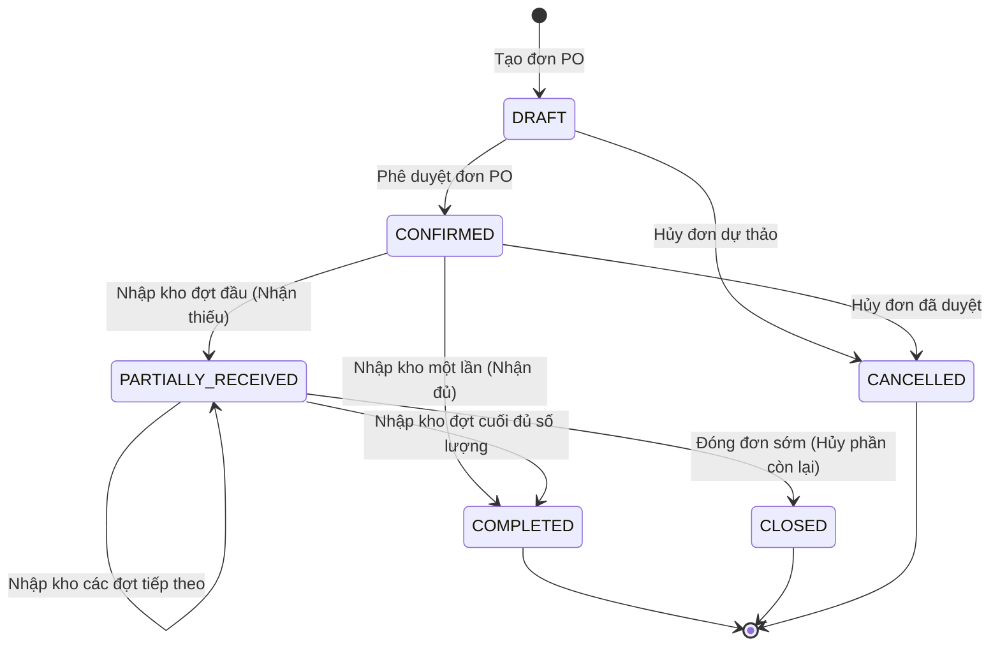
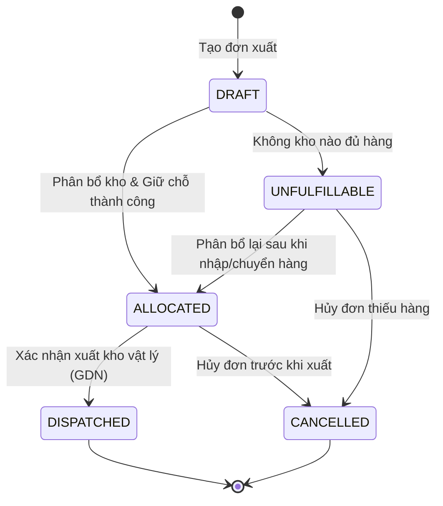
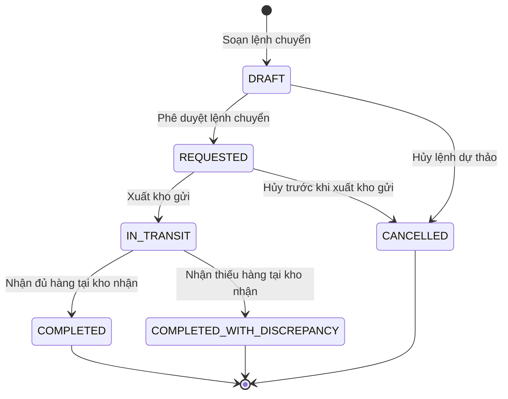
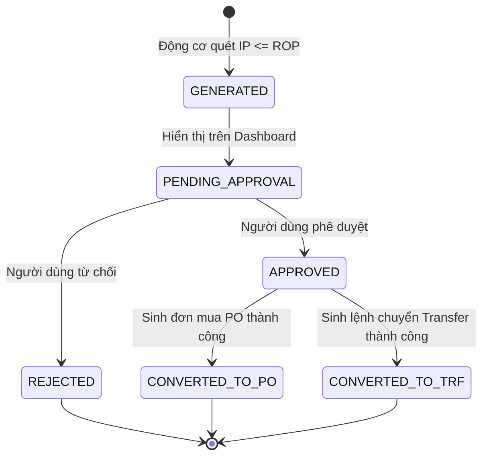

# TÀI LIỆU QUY TẮC NGHIỆP VỤ, BẢNG QUYẾT ĐỊNH VÀ MÁY TRẠNG THÁI (BUSINESS RULES SPECIFICATION)

**Đề tài:** Xây dựng nền tảng quản lý kho và phân phối hàng hóa thông minh ứng dụng AI dự báo nhu cầu và hỗ trợ tối ưu tồn kho  
**Loại tài liệu:** Đặc tả quy tắc nghiệp vụ (Business Rules), Bảng quyết định (Decision Tables) và Máy trạng thái (State Machines)  
**Trạng thái tài liệu:** Bản dự thảo chính thức (Chuyển tiếp từ [`docs/01_problem_scope.md`](file:///d:/DO_AN_TOT_NGHIEP/docs/01_problem_scope.md) và [`docs/02_business_requirements.md`](file:///d:/DO_AN_TOT_NGHIEP/docs/02_business_requirements.md))  
**Môi trường xác lập:** Môi trường doanh nghiệp giả lập; phát triển dựa trên mô hình nghiệp vụ chuẩn hóa và dữ liệu giả lập (synthetic data).

---

## Phần 1. Thông tin và Phạm vi

### 1.1. Mục đích tài liệu
Tài liệu này chi tiết hóa toàn bộ các quy tắc logic nghiệp vụ, công thức toán học, ràng buộc bất biến cơ sở dữ liệu và máy trạng thái giao dịch cho hệ thống quản lý kho và phân phối đa điểm. Mục tiêu là:
- Loại bỏ hoàn toàn sự mơ hồ logic trước khi thiết kế mô hình dữ liệu (`docs/04_data_dictionary.md`) và kiến trúc kỹ thuật.
- Cung cấp căn cứ kiểm chứng độc lập cho từng kịch bản kiểm thử (Test Scenarios).
- Đảm bảo tính toàn vẹn dữ liệu giao dịch (ACID), chống tồn âm, chống ghi nhận trùng lặp và bảo vệ số dư kho trong môi trường đa kho xử lý đồng thời.

### 1.2. Tài liệu tham chiếu
- [`GEMINI.md`](file:///d:/DO_AN_TOT_NGHIEP/GEMINI.md) — Nguyên tắc làm việc kỹ thuật, chuẩn mực trung thực và kỷ luật đồ án.
- [`docs/01_problem_scope.md`](file:///d:/DO_AN_TOT_NGHIEP/docs/01_problem_scope.md) — Xác định bài toán, phạm vi Core MVP / Advanced MVP và 8 ca kiểm thử nghiệm thu.
- [`docs/02_business_requirements.md`](file:///d:/DO_AN_TOT_NGHIEP/docs/02_business_requirements.md) — Đặc tả danh mục yêu cầu chức năng (FR) và phi chức năng (NFR).

### 1.3. Thuật ngữ và Ký hiệu toán học

| Ký hiệu / Thuật ngữ | Tên tiếng Anh | Ý nghĩa nghiệp vụ |
| :--- | :--- | :--- |
| $\text{On-hand}$ | On-hand Inventory | Số lượng hàng vật lý thực tế đang có mặt trong kho tại thời điểm xét. |
| $\text{Allocated}$ | Allocated / Reserved Stock | Số lượng hàng đã cam kết cho đơn xuất/chuyển kho nhưng chưa xuất vật lý. |
| $\text{Available}$ | Available-to-Promise (ATP) | Tồn khả dụng tự do để bán hoặc điều chuyển: $\text{Available} = \text{On-hand} - \text{Allocated}$. |
| $\text{On-order}$ | On-order Quantity | Lượng hàng đã đặt mua từ NCC hoặc hàng điều chuyển đang trên đường về kho nhận. |
| $\text{In-transit}$ | In-transit Stock | Hàng đã xuất khỏi kho gửi nhưng chưa nhập kho nhận trong lệnh điều chuyển. |
| $\text{IP}$ | Inventory Position | Vị thế tồn kho phục vụ bổ sung: $\text{IP} = \text{Available} + \text{On-order}$. |
| $\text{ROP}$ | Reorder Point | Điểm đặt hàng lại (ngưỡng kích hoạt xem xét bổ sung hàng). |
| $\text{SS}$ | Safety Stock | Mức tồn kho an toàn phòng ngừa rủi ro sai số dự báo và trễ giao hàng. |
| $L$ | Lead Time | Thời gian bổ sung hàng (tính bằng ngày) từ lúc đặt hàng/lập lệnh đến khi nhập kho. |
| $\hat{D}_{\text{lead}}$ | Lead-time Forecast Demand | Tổng nhu cầu tiêu thụ dự báo trong khoảng thời gian Lead time $L$. |
| $S$ | Order-up-to Level | Mức tồn kho mục tiêu tối đa của chính sách tồn kho định kỳ. |
| $Q_{\text{suggest}}$ | Suggested Order Quantity | Số lượng hàng đề xuất bổ sung (nhập mua hoặc điều chuyển). |
| $\text{MOQ}$ | Minimum Order Quantity | Số lượng đặt hàng tối thiểu theo quy định của nhà cung cấp hoặc đóng gói. |

### 1.4. Quy ước đánh mã Quy tắc nghiệp vụ (Business Rule ID)
Mỗi quy tắc được gán mã duy nhất theo cấu trúc: `BR-[PHÂN HỆ]-[SỐ THỨ TỰ]`:
- `BR-INV-xxx`: Quy tắc số dư tồn kho và ràng buộc bất biến (Inventory Balance Rules).
- `BR-INB-xxx`: Quy tắc nhập kho từ nhà cung cấp (Inbound Rules).
- `BR-OUT-xxx`: Quy tắc xuất kho và giữ chỗ (Outbound & Reservation Rules).
- `BR-TRF-xxx`: Quy tắc điều chuyển kho nội bộ (Transfer Rules).
- `BR-ORD-xxx`: Quy tắc phân bổ đơn hàng và điều phối (Allocation Rules).
- `BR-AI-xxx`: Quy tắc dữ liệu và đánh giá mô hình AI (AI & Forecasting Rules).
- `BR-REC-xxx`: Quy tắc tính toán bổ sung và cảnh báo tồn kho (Replenishment Rules).
- `BR-CON-xxx`: Quy tắc kiểm soát tương tranh và toàn vẹn giao dịch (Concurrency Rules).

---

## Phần 2. Quy tắc Số dư Tồn kho (Inventory Balance Rules - BR-INV)

### 2.1. Định nghĩa và Mối quan hệ toán học giữa các số dư
Hệ thống quản lý trạng thái tồn kho cho từng SKU tại từng kho hàng theo 5 chỉ số độc lập và 1 chỉ số tổng hợp:

```
┌─────────────────────────────────────────────────────────────┐
│                  TỒN VẬT LÝ TRONG KHO                       │
│                        (On-hand)                            │
│  ┌───────────────────────────────┬───────────────────────┐  │
│  │   Tồn khả dụng (Available)    │ Tồn giữ chỗ (Allocated)│  │
│  └───────────────────────────────┴───────────────────────┘  │
└─────────────────────────────────────────────────────────────┘
                                  ▲
                                  │ (Khi nhập kho thực tế)
┌─────────────────────────────────┴───────────────────────────┐
│                    HÀNG ĐANG VỀ (On-order)                  │
│  ┌───────────────────────────────┬───────────────────────┐  │
│  │  Đơn PO chờ NCC giao hàng     │  In-transit chuyển kho │  │
│  └───────────────────────────────┴───────────────────────┘  │
└─────────────────────────────────────────────────────────────┘
```

#### `BR-INV-001`: Công thức Tồn khả dụng và Ràng buộc bất biến
- **Công thức:**
  $$\text{Available} = \text{On-hand} - \text{Allocated}$$
- **Ràng buộc bất biến bắt buộc (System Invariant):**
  1. Luôn luôn thỏa mãn: $\text{Available} \ge 0$.
  2. Luôn luôn thỏa mãn: $\text{On-hand} \ge \text{Allocated} \ge 0$.
  3. Cài đặt ràng buộc toàn vẹn cơ sở dữ liệu (`CHECK Constraint`):
     ```sql
     CHECK (on_hand >= allocated AND on_hand >= 0 AND allocated >= 0)
     ```
- **Xử lý vi phạm:** Bất kỳ câu lệnh `UPDATE` nào làm $\text{on_hand} < \text{allocated}$ đều bị cơ sở dữ liệu từ chối tức thời và Rollback toàn bộ transaction.

#### `BR-INV-002`: Công thức Vị thế tồn kho (Inventory Position - IP)
- **Công thức:**
  $$\text{IP} = \text{Available} + \text{On-order} = (\text{On-hand} - \text{Allocated}) + \text{On-order}$$
- **Ý nghĩa nghiệp vụ:** Chỉ số $\text{IP}$ đại diện cho toàn bộ lượng hàng sẵn sàng đáp ứng nhu cầu hiện tại và tương lai gần. Động cơ tính toán bổ sung bắt buộc phải so sánh $\text{IP}$ với $\text{ROP}$, **tuyệt đối không dùng $\text{On-hand}$ hoặc $\text{Available}$ đứng một mình** để tránh đặt hàng thừa khi hàng đang trên đường về.

#### `BR-INV-003`: Nguyên tắc cách ly Hàng đang đi đường (In-transit Isolation)
- Hàng đang đi đường ($\text{In-transit}$) phát sinh khi kho gửi đã xuất hàng nhưng kho nhận chưa nhận.
- **Ràng buộc cách ly:**
  1. Số lượng $\text{In-transit}$ **không** nằm trong $\text{On-hand}$ của kho gửi (đã trừ khi xuất đi).
  2. Số lượng $\text{In-transit}$ **chưa** nằm trong $\text{On-hand}$ hoặc $\text{Available}$ của kho nhận (chỉ được ghi nhận trong $\text{On-order}$ của kho nhận).
  3. Chỉ khi nhân viên kho nhận kiểm đếm thực tế và bấm "Xác nhận nhận hàng", số lượng thực nhận mới được chuyển từ $\text{On-order}$ sang $\text{On-hand}$ của kho nhận.

### 2.2. Ma trận Thời điểm Biến động Số dư theo Sự kiện

Bảng dưới đây quy định chính xác thời điểm mỗi số dư tăng $(+)$, giảm $(-)$ hoặc giữ nguyên $(=)$:

| Mã sự kiện nghiệp vụ | Tác động Kho gửi / Kho nguồn | Tác động Kho nhận / Kho đích | Số dư In-transit | Audit Movement Type |
| :--- | :--- | :--- | :--- | :--- |
| **PO được duyệt (`CONFIRMED`)** | Không áp dụng | $\text{On-order} \mathrel{+}= Q$ | Không đổi | Không (chưa vào kho) |
| **Hủy PO (`CANCELLED`)** | Không áp dụng | $\text{On-order} \mathrel{-}= Q_{\text{rem}}$ | Không đổi | Không |
| **GRN nhận hàng từ NCC** | Không áp dụng | $\text{On-hand} \mathrel{+}= Q_{\text{act}}$<br>$\text{On-order} \mathrel{-}= Q_{\text{act}}$<br>$\text{Available} \mathrel{+}= Q_{\text{act}}$ | Không đổi | `INBOUND_RECEIPT` |
| **Giữ chỗ đơn xuất kho** | $\text{Allocated} \mathrel{+}= Q$<br>$\text{Available} \mathrel{-}= Q$<br>$\text{On-hand}$ không đổi | Không áp dụng | Không đổi | `OUTBOUND_RESERVE` |
| **Hủy giữ chỗ đơn xuất** | $\text{Allocated} \mathrel{-}= Q$<br>$\text{Available} \mathrel{+}= Q$<br>$\text{On-hand}$ không đổi | Không áp dụng | Không đổi | `RESERVE_CANCEL` |
| **GDN xuất kho vật lý** | $\text{On-hand} \mathrel{-}= Q$<br>$\text{Allocated} \mathrel{-}= Q$<br>$\text{Available}$ không đổi | Không áp dụng | Không đổi | `OUTBOUND_DISPATCH` |
| **Lập lệnh chuyển kho (`REQUESTED`)** | $\text{Allocated} \mathrel{+}= Q$<br>$\text{Available} \mathrel{-}= Q$<br>$\text{On-hand}$ không đổi | $\text{On-order} \mathrel{+}= Q$<br>$\text{On-hand}, \text{Available}$ không đổi | Không đổi | `TRANSFER_RESERVE` |
| **Hủy lệnh chuyển kho** | $\text{Allocated} \mathrel{-}= Q$<br>$\text{Available} \mathrel{+}= Q$ | $\text{On-order} \mathrel{-}= Q$ | Không đổi | `TRANSFER_CANCEL` |
| **Xuất kho chuyển đi (`DISPATCHED`)** | $\text{On-hand} \mathrel{-}= Q$<br>$\text{Allocated} \mathrel{-}= Q$ | $\text{On-hand}, \text{Available}$ không đổi | $\text{In-transit} \mathrel{+}= Q$ | `TRANSFER_DISPATCH` |
| **Nhập kho nhận chuyển kho (Đủ/Thiếu)** | Không đổi | $\text{On-hand} \mathrel{+}= Q_{\text{act}}$<br>$\text{On-order} \mathrel{-}= Q$<br>$\text{Available} \mathrel{+}= Q_{\text{act}}$ | $\text{In-transit} \mathrel{-}= Q$ | `TRANSFER_RECEIPT` |
| **Ghi nhận hao hụt chuyển kho** | Không đổi | Không đổi | $\text{In-transit}$ đã trừ hết ở trên | `DISCREPANCY_LOSS` |

### 2.3. Quy tắc Đối soát Số dư với Nhật ký Kiểm toán (Audit Reconciliation)
#### `BR-INV-004`: Quy tắc Đối soát Tổng biến động và Số dư Cam kết
- **Sổ cái biến động kho `stock_movement_logs`:** Là nguồn sự thật duy nhất (Single Source of Truth) đối với biến động hàng hóa vật lý (`On-hand`) và cam kết giữ chỗ nội bộ (`Allocated`) tại từng kho.
- **Công thức đối soát tính đúng đắn tồn vật lý:**
  Đối với mọi cặp `(sku_id, warehouse_id)`, tại bất kỳ thời điểm $T$:
  $$\text{On-hand}(T) = \text{On-hand}(T_0) + \sum_{t=T_0}^{T} \Delta \text{On-hand}_{\text{log}}(t)$$
  $$\text{Allocated}(T) = \text{Allocated}(T_0) + \sum_{t=T_0}^{T} \Delta \text{Allocated}_{\text{log}}(t)$$
- **Quy tắc đối soát số dư cam kết hàng đang về (`On-order`):**
  Số dư `On-order` đại diện cho cam kết mua hàng hoặc điều chuyển đang trên đường đến kho, không phải là hàng hóa đã nhập vào kho vật lý. Do đó, `On-order` được kiểm toán độc lập bằng cách tổng hợp trực tiếp từ các chứng từ cam kết còn hiệu lực tại thời điểm $T$:
  $$\text{On-order}_{\text{wh}}(T) = \sum_{\text{PO} \in \{\text{CONFIRMED, PARTIALLY\_RECEIVED}\}} (Q_{\text{ordered}} - Q_{\text{received\_total}}) + \sum_{\text{TRF} \in \{\text{REQUESTED, IN\_TRANSIT}\}} Q_{\text{transfer}}$$
- Nếu có sự sai lệch giữa giá trị trường trong bảng số dư và tổng đại số kiểm toán tương ứng, hệ thống ghi nhận lỗi bất thường dữ liệu và kích hoạt cảnh báo kỹ thuật.

---

## Phần 3. Quy tắc Nhập kho từ Nhà Cung Cấp (Inbound Rules - BR-INB)

### 3.1. Vòng đời Đơn mua hàng (Purchase Order - PO)
Đơn mua hàng quản lý cam kết nhập hàng từ nhà cung cấp bên ngoài.

#### `BR-INB-001`: Tạo và Phê duyệt Đơn PO
- **Điều kiện:** SKU và Nhà cung cấp phải ở trạng thái hoạt động (`ACTIVE`). Số lượng đặt $Q_{\text{PO}} > 0$.
- **Xử lý:**
  1. Đơn PO khởi tạo ở trạng thái `DRAFT` (chưa tác động tồn kho).
  2. Khi Quản lý kho duyệt đơn $\implies$ Chuyển trạng thái sang `CONFIRMED`.
  3. Tăng số lượng hàng đang về tại kho đích:
     $$\text{On-order}_{\text{dest}} \mathrel{+}= Q_{\text{PO}}$$
  4. $\text{On-hand}$ và $\text{Available}$ tại kho đích giữ nguyên không đổi.

#### `BR-INB-002`: Xác nhận Nhập kho Đủ (Full Goods Receipt)
- **Điều kiện:** Đơn PO ở trạng thái `CONFIRMED` hoặc `PARTIALLY_RECEIVED`. Số lượng thực nhận trên phiếu GRN bằng đúng số lượng còn lại của PO ($Q_{\text{actual}} = Q_{\text{remaining}}$).
- **Xử lý trong transaction:**
  1. Tăng tồn thực tế: $\text{On-hand} \mathrel{+}= Q_{\text{actual}}$.
  2. Giảm hàng đang về: $\text{On-order} \mathrel{-}= Q_{\text{actual}}$.
  3. Tồn khả dụng tự động tăng tương ứng: $\text{Available} \mathrel{+}= Q_{\text{actual}}$.
  4. Cập nhật số lượng đã nhận của PO: $Q_{\text{received\_total}} = Q_{\text{PO}}$.
  5. Đơn PO chuyển trạng thái sang `COMPLETED`.
  6. Ghi 01 bản ghi vào `stock_movement_log` loại `INBOUND_RECEIPT`.

#### `BR-INB-003`: Xử lý Nhập kho Một phần (Partial Goods Receipt)
- **Điều kiện:** Đơn PO ở trạng thái `CONFIRMED` hoặc `PARTIALLY_RECEIVED`. Số lượng thực nhận đợt này $0 < Q_{\text{actual}} < Q_{\text{remaining}}$.
- **Xử lý trong transaction:**
  1. Tăng tồn thực tế theo số thực nhận: $\text{On-hand} \mathrel{+}= Q_{\text{actual}}$.
  2. Giảm hàng đang về đúng bằng số thực nhận: $\text{On-order} \mathrel{-}= Q_{\text{actual}}$.
  3. Cập nhật lũy kế nhận của PO: $Q_{\text{received\_total}} \mathrel{+}= Q_{\text{actual}}$.
  4. Tính số lượng còn lại đang chờ giao:
     $$Q_{\text{remaining}} = Q_{\text{PO}} - Q_{\text{received\_total}}$$
  5. Lượng $Q_{\text{remaining}}$ tiếp tục nằm trong $\text{On-order}$ của kho đích.
  6. Đơn PO chuyển trạng thái sang `PARTIALLY_RECEIVED`.
  7. Phiếu GRN đợt này lưu trạng thái `COMPLETED` với số lượng $Q_{\text{actual}}$.

#### `BR-INB-004`: Nhập kho Lũy kế nhiều đợt cho cùng một Đơn PO (Multiple Partial Receipts)
- **Điều kiện:** Đơn PO đang ở trạng thái `PARTIALLY_RECEIVED`.
- **Xử lý:**
  1. Mỗi đợt giao hàng tiếp theo tạo một phiếu GRN độc lập gắn với mã PO.
  2. Áp dụng quy tắc `BR-INB-003` để tăng $\text{On-hand}$ và trừ dần $\text{On-order}$ tương ứng với từng phiếu GRN.
  3. Khi đợt nhận cuối cùng làm $Q_{\text{received\_total}} = Q_{\text{PO}}$, đơn PO tự động chuyển từ `PARTIALLY_RECEIVED` sang `COMPLETED`.

#### `BR-INB-005`: Hủy hoặc Đóng đơn PO khi không giao hết (Force Close PO)
- **Điều kiện:** Đơn PO ở trạng thái `PARTIALLY_RECEIVED` và nhà cung cấp thông báo không thể giao tiếp phần còn lại ($Q_{\text{remaining}}$).
- **Xử lý:**
  1. Quản lý kho thực hiện thao tác "Đóng đơn PO" kèm lý do.
  2. Trừ toàn bộ số lượng chưa giao khỏi hàng đang về:
     $$\text{On-order} \mathrel{-}= Q_{\text{remaining}}$$
  3. $\text{On-hand}$ và $\text{Available}$ không đổi.
  4. Đơn PO chuyển trạng thái sang `CLOSED`.

### 3.2. Bảng Tính toán Số dư Trước/Sau Nhập kho (Ví dụ mẫu)
*Giả định ban đầu:* SKU `SP01` tại Kho 1 có $\text{On-hand}=10, \text{Allocated}=2 \implies \text{Available}=8, \text{On-order}=0$.

| Bước thực hiện | Thao tác | Số lượng | On-hand | Allocated | Available | On-order | IP | Trạng thái PO |
| :---: | :--- | :---: | :---: | :---: | :---: | :---: | :---: | :---: |
| 0 | Ban đầu | - | 10 | 2 | 8 | 0 | 8 | - |
| 1 | Duyệt đơn PO | 50 | 10 | 2 | 8 | **50** | **58** | `CONFIRMED` |
| 2 | Nhập đợt 1 (GRN1) | 30 | **40** | 2 | **38** | **20** | 58 | `PARTIALLY_RECEIVED` |
| 3 | Nhập đợt 2 (GRN2) | 20 | **60** | 2 | **58** | **0** | 58 | `COMPLETED` |

---

## Phần 4. Quy tắc Xuất kho và Giữ chỗ (Outbound Rules - BR-OUT)

### 4.1. Quy tắc Giữ chỗ và Xuất kho
#### `BR-OUT-001`: Kiểm tra Khả năng đáp ứng trước khi Giữ chỗ
- **Điều kiện:** Đơn xuất kho cần xuất số lượng $Q_{\text{order}}$ tại kho $W$.
- **Quy tắc:**
  - Nếu $\text{Available}_W \ge Q_{\text{order}}$: Cho phép giữ chỗ.
  - Nếu $\text{Available}_W < Q_{\text{order}}$: Từ chối giữ chỗ, không trừ số dư, báo lỗi `INSUFFICIENT_STOCK`.

#### `BR-OUT-002`: Thực hiện Giữ chỗ tồn kho (Stock Reservation)
- **Xử lý:**
  $$\text{Allocated} \mathrel{+}= Q_{\text{order}} \implies \text{Available} \mathrel{-}= Q_{\text{order}}$$
  $\text{On-hand}$ **không thay đổi** vì hàng vẫn nằm trên giá kệ vật lý.
- Đơn xuất chuyển trạng thái `ALLOCATED`.

#### `BR-OUT-003`: Hủy Giữ chỗ khi Đơn hàng bị Hủy (Reservation Cancellation)
- **Điều kiện:** Đơn hàng đang ở trạng thái `ALLOCATED` (chưa xuất kho vật lý).
- **Xử lý:**
  $$\text{Allocated} \mathrel{-}= Q_{\text{order}} \implies \text{Available} \mathrel{+}= Q_{\text{order}}$$
  $\text{On-hand}$ không đổi. Đơn hàng chuyển sang `CANCELLED`.

#### `BR-OUT-004`: Xác nhận Xuất kho Vật lý (Goods Dispatch)
- **Điều kiện:** Đơn hàng ở trạng thái `ALLOCATED`. Phiếu GDN được xác nhận bởi thủ kho.
- **Xử lý trong transaction:**
  $$\text{On-hand} \mathrel{-}= Q_{\text{order}}$$
  $$\text{Allocated} \mathrel{-}= Q_{\text{order}}$$
  $\text{Available}$ **không đổi** (vì $\Delta \text{On-hand} = \Delta \text{Allocated} = -Q_{\text{order}}$).
- Đơn xuất chuyển trạng thái `DISPATCHED`. Ghi 01 bản ghi `OUTBOUND_DISPATCH` vào audit log.

#### `BR-OUT-005`: Quy tắc Xử lý Hủy sau khi đã Xuất kho Vật lý
- **Quy tắc cấm:** Tuyệt đối **không cho phép bấm nút "Hủy đơn"** khi đơn hàng đã chuyển sang `DISPATCHED`. Không được sửa hoặc xóa bản ghi giao dịch trong lịch sử.
- **Quy trình xử lý:** Hàng đã xuất đi nếu khách từ chối nhận hoặc trả hàng bắt buộc phải thực hiện thông qua nghiệp vụ **Nhập trả hàng (Customer Return / Return Receipt Note)** để tạo một phiếu nhập kho độc lập, ghi tăng $\text{On-hand}$ trở lại kèm biên bản kiểm định chất lượng hàng trả.

### 4.2. Bảng Tính toán Số dư Trước/Sau Xuất kho (Ví dụ mẫu)
*Giả định ban đầu:* Kho có $\text{On-hand}=20, \text{Allocated}=5 \implies \text{Available}=15$.

| Bước thực hiện | Thao tác | Số lượng | On-hand | Allocated | Available | IP | Trạng thái Đơn |
| :---: | :--- | :---: | :---: | :---: | :---: | :---: | :---: |
| 0 | Ban đầu | - | 20 | 5 | 15 | 15 | - |
| 1 | Giữ chỗ đơn A | 10 | 20 | **15** | **5** | 15 | `ALLOCATED` |
| 2a | Nhánh 1: Xuất kho GDN đơn A | 10 | **10** | **5** | 5 | **5** | `DISPATCHED` |
| 2b | Nhánh 2: Hủy đơn A (chưa xuất) | 10 | 20 | **5** | **15** | 15 | `CANCELLED` |

---

## Phần 5. Quy tắc Điều chuyển Kho Nội bộ (Transfer Rules - BR-TRF)

### 5.1. Quy trình Điều chuyển 3 Giai đoạn
Quá trình điều chuyển hàng từ Kho gửi ($W_A$) sang Kho nhận ($W_B$) với số lượng $Q_{\text{transfer}}$ tuân thủ nghiêm ngặt 3 giai đoạn:

```
[Giai đoạn 1: Lập lệnh] ───> [Giai đoạn 2: Xuất kho gửi] ───> [Giai đoạn 3: Nhập kho nhận]
Kho A: Giữ chỗ (Allocated+)   Kho A: Xuất vật lý (On-hand-)    Kho B: Tăng tồn (On-hand+)
Kho B: Hàng về (On-order+)    Hệ thống: Tăng In-transit        Hệ thống: Xóa In-transit
```

#### `BR-TRF-001`: Giai đoạn 1 - Lập lệnh điều chuyển (Transfer Request)
- **Điều kiện:** Kho gửi phải có $\text{Available}_A \ge Q_{\text{transfer}}$.
- **Xử lý:**
  1. Kho gửi $A$: Tăng giữ chỗ $\text{Allocated}_A \mathrel{+}= Q_{\text{transfer}} \implies \text{Available}_A \mathrel{-}= Q_{\text{transfer}}$.
  2. Kho nhận $B$: Tăng hàng đang về $\text{On-order}_B \mathrel{+}= Q_{\text{transfer}}$.
  3. $\text{On-hand}_A$ và $\text{On-hand}_B$ **chưa thay đổi**.
  4. Lệnh chuyển ở trạng thái `REQUESTED`.

#### `BR-TRF-002`: Hủy lệnh điều chuyển trước khi xuất kho gửi
- **Điều kiện:** Lệnh chuyển đang ở trạng thái `REQUESTED` (chưa bốc dỡ hàng lên xe).
- **Xử lý:**
  1. Kho gửi $A$: Giảm $\text{Allocated}_A \mathrel{-}= Q_{\text{transfer}} \implies \text{Available}_A$ phục hồi.
  2. Kho nhận $B$: Giảm $\text{On-order}_B \mathrel{-}= Q_{\text{transfer}}$.
  3. Lệnh chuyển chuyển sang `CANCELLED`.

#### `BR-TRF-003`: Giai đoạn 2 - Xuất kho gửi (Dispatch Transfer)
- **Điều kiện:** Lệnh chuyển ở trạng thái `REQUESTED`.
- **Xử lý trong transaction:**
  1. Kho gửi $A$: Hàng thực xuất khỏi kho $\implies \text{On-hand}_A \mathrel{-}= Q_{\text{transfer}}$ và $\text{Allocated}_A \mathrel{-}= Q_{\text{transfer}}$.
  2. Hệ thống: Ghi nhận số dư hàng đi đường $\text{In-transit} \mathrel{+}= Q_{\text{transfer}}$.
  3. Kho nhận $B$: $\text{On-hand}_B$ và $\text{Available}_B$ **vẫn giữ nguyên chưa tăng**.
  4. Lệnh chuyển chuyển sang trạng thái `IN_TRANSIT`. Ghi audit log loại `TRANSFER_DISPATCH`.

#### `BR-TRF-004`: Giai đoạn 3a - Nhập kho nhận Đầy đủ (Full Receipt)
- **Điều kiện:** Lệnh chuyển ở trạng thái `IN_TRANSIT`. Số lượng kiểm đếm thực nhận bằng đúng số lượng xuất: $Q_{\text{received}} = Q_{\text{transfer}}$.
- **Xử lý trong transaction:**
  1. Kho nhận $B$: Tăng tồn thực tế $\text{On-hand}_B \mathrel{+}= Q_{\text{received}} \implies \text{Available}_B$ tăng $Q_{\text{received}}$.
  2. Kho nhận $B$: Giảm hàng đang về $\text{On-order}_B \mathrel{-}= Q_{\text{transfer}}$.
  3. Hệ thống: Xóa toàn bộ số lượng đi đường $\text{In-transit} \mathrel{-}= Q_{\text{transfer}}$.
  4. Lệnh chuyển chuyển sang `COMPLETED`. Ghi audit log loại `TRANSFER_RECEIPT`.

#### `BR-TRF-005`: Giai đoạn 3b - Nhập kho nhận Thiếu / Hao hụt / Mất toàn bộ (Under-receiving)
- **Điều kiện:** Lệnh chuyển ở trạng thái `IN_TRANSIT`. Số lượng kiểm đếm thực nhận nhỏ hơn số lượng xuất đi: $0 \le Q_{\text{received}} < Q_{\text{transfer}}$ do rơi vỡ, hư hỏng hoặc thất thoát trong quá trình vận chuyển.
- **Xử lý trong transaction:**
  1. Kho nhận $B$: **Chỉ tăng tồn thực tế theo đúng số lượng thực nhận**:
     $$\text{On-hand}_B \mathrel{+}= Q_{\text{received}} \implies \text{Available}_B \mathrel{+}= Q_{\text{received}}$$
     *(Nếu $Q_{\text{received}} = 0$, tồn thực tế kho B không đổi).*
  2. Kho nhận $B$: Giảm toàn bộ số lượng của lệnh khỏi hàng đang về:
     $$\text{On-order}_B \mathrel{-}= Q_{\text{transfer}}$$
  3. Hệ thống: Giảm toàn bộ số lượng của lệnh khỏi hàng đi đường:
     $$\text{In-transit} \mathrel{-}= Q_{\text{transfer}}$$
     *(Mục đích: Đóng dứt điểm lệnh chuyển, không để treo số dư ảo trên đường đi).*
  4. Tính toán số lượng hao hụt/thất thoát:
     $$\Delta Q_{\text{loss}} = Q_{\text{transfer}} - Q_{\text{received}}$$
  5. Tự động ghi 01 bản ghi vào bảng `discrepancy_logs` gồm: `transfer_id`, `transfer_item_id`, `sku_id`, `discrepancy_qty` $= \Delta Q_{\text{loss}}$, `reason`, `reported_by`, và cờ `is_total_loss = (Q_{\text{received}} == 0)`.
  6. Ghi audit log loại `TRANSFER_RECEIPT` cho kho B với $\Delta \text{On-hand} = +Q_{\text{received}}$. Tuyệt đối không ghi trừ thêm tại kho B vì lượng thất thoát chưa từng nhập vào kho B.
  7. Lệnh chuyển chuyển sang trạng thái `COMPLETED_WITH_DISCREPANCY`.

### 5.2. Bảng Tính toán Số dư Trước/Sau Điều chuyển (Ví dụ số cụ thể)
*Kịch bản:* Chuyển $Q=10$ cái từ Kho A sang Kho B. Thực nhận tại B chỉ có $Q_{\text{received}}=9$ cái (mất 1 cái).

| Mốc sự kiện | On-hand A | Alloc A | Avail A | In-transit | On-hand B | On-order B | Avail B | IP B | Trạng thái Lệnh |
| :--- | :---: | :---: | :---: | :---: | :---: | :---: | :---: | :---: | :---: |
| **0. Ban đầu** | 20 | 0 | 20 | 0 | 5 | 0 | 5 | 5 | - |
| **1. Lập lệnh chuyển 10 cái** | 20 | **10** | **10** | 0 | 5 | **10** | 5 | **15** | `REQUESTED` |
| **2. Xuất kho gửi A** | **10** | **0** | 10 | **10** | 5 | 10 | 5 | 15 | `IN_TRANSIT` |
| **3. Kho B nhận 9 cái (thiếu 1)** | 10 | 0 | 10 | **0** | **14** | **0** | **14** | **14** | `COMPLETED_WITH_DISCREPANCY` |

*Ghi chú kết quả:* Kho A mất 10 cái. Kho B nhận được 9 cái. Hệ thống ghi nhận thất thoát 1 cái vào `discrepancy_log`. Tổng tồn toàn hệ thống giảm 1 cái đúng bằng số lượng thất thoát thực tế.

---

## Phần 6. Máy Trạng thái và Bảng Quyết định (State Machines)

### 6.1. Máy trạng thái Đơn mua hàng (Purchase Order State Machine)



**Bảng chuyển trạng thái Purchase Order:**

| Trạng thái nguồn | Sự kiện kích hoạt | Điều kiện chuyển | Trạng thái đích | Chuyển trạng thái bị cấm | Tác động số dư tồn kho |
| :--- | :--- | :--- | :--- | :--- | :--- |
| `DRAFT` | `APPROVE_PO` | Quản lý kho duyệt | `CONFIRMED` | Không thể sang `COMPLETED` | $\text{On-order} \mathrel{+}= Q_{\text{PO}}$ |
| `DRAFT` | `CANCEL_PO` | Người tạo hủy | `CANCELLED` | - | Không đổi số dư |
| `CONFIRMED` | `RECEIVE_FULL` | GRN nhận đủ $Q$ | `COMPLETED` | Không thể về `DRAFT` | $\text{On-hand} \mathrel{+}= Q, \text{On-order} \mathrel{-}= Q$ |
| `CONFIRMED` | `RECEIVE_PARTIAL` | GRN nhận $Q_{\text{act}} < Q$ | `PARTIALLY_RECEIVED` | Không thể sang `CLOSED` trực tiếp | $\text{On-hand} \mathrel{+}= Q_{\text{act}}, \text{On-order} \mathrel{-}= Q_{\text{act}}$ |
| `CONFIRMED` | `CANCEL_PO` | Chưa có GRN nào | `CANCELLED` | Không thể hủy nếu đã có GRN | $\text{On-order} \mathrel{-}= Q_{\text{PO}}$ |
| `PARTIALLY_RECEIVED` | `RECEIVE_PARTIAL` | GRN tiếp theo vẫn thiếu | `PARTIALLY_RECEIVED` | - | $\text{On-hand} \mathrel{+}= Q_{\text{act}}, \text{On-order} \mathrel{-}= Q_{\text{act}}$ |
| `PARTIALLY_RECEIVED` | `RECEIVE_FINAL` | Tổng nhận đủ $Q_{\text{PO}}$ | `COMPLETED` | - | $\text{On-hand} \mathrel{+}= Q_{\text{act}}, \text{On-order} \mathrel{-}= Q_{\text{act}}$ |
| `PARTIALLY_RECEIVED` | `FORCE_CLOSE` | NCC ngừng giao | `CLOSED` | Không thể về `CONFIRMED` | $\text{On-order} \mathrel{-}= Q_{\text{rem}}$ |

---

### 6.2. Máy trạng thái Đơn xuất kho (Outbound Order State Machine)



**Bảng chuyển trạng thái Outbound Order:**

| Trạng thái nguồn | Sự kiện kích hoạt | Điều kiện chuyển | Trạng thái đích | Chuyển trạng thái bị cấm | Tác động số dư tồn kho |
| :--- | :--- | :--- | :--- | :--- | :--- |
| `DRAFT` | `ALLOCATE_SUCCESS` | Có kho thỏa $\text{Available} \ge Q$ | `ALLOCATED` | Không thể sang `DISPATCHED` | $\text{Allocated} \mathrel{+}= Q, \text{Available} \mathrel{-}= Q$ |
| `DRAFT` | `ALLOCATE_FAIL` | Không kho nào đủ hàng | `UNFULFILLABLE` | Không được giữ chỗ | Không đổi số dư; kích hoạt Alert |
| `UNFULFILLABLE` | `RETRY_ALLOCATE` | Tồn kho đã được bổ sung | `ALLOCATED` | - | $\text{Allocated} \mathrel{+}= Q, \text{Available} \mathrel{-}= Q$ |
| `ALLOCATED` | `CANCEL_ORDER` | Hủy trước khi xuất GDN | `CANCELLED` | Cấm hủy nếu đã `DISPATCHED` | $\text{Allocated} \mathrel{-}= Q, \text{Available} \mathrel{+}= Q$ |
| `ALLOCATED` | `CONFIRM_DISPATCH` | Đã bốc dỡ xong hàng | `DISPATCHED` | Không thể về `DRAFT` | $\text{On-hand} \mathrel{-}= Q, \text{Allocated} \mathrel{-}= Q$ |

---

### 6.3. Máy trạng thái Lệnh điều chuyển kho (Transfer Order State Machine)



**Bảng chuyển trạng thái Transfer Order:**

| Trạng thái nguồn | Sự kiện kích hoạt | Điều kiện chuyển | Trạng thái đích | Chuyển trạng thái bị cấm | Tác động số dư tồn kho |
| :--- | :--- | :--- | :--- | :--- | :--- |
| `DRAFT` | `APPROVE_TRANSFER` | Kho gửi đủ $\text{Available} \ge Q$ | `REQUESTED` | Cấm sang `IN_TRANSIT` | $\text{Alloc}_A \mathrel{+}= Q, \text{Avail}_A \mathrel{-}= Q, \text{On-order}_B \mathrel{+}= Q$ |
| `REQUESTED` | `CANCEL_TRANSFER` | Chưa xuất kho gửi | `CANCELLED` | Cấm hủy nếu đã `IN_TRANSIT` | $\text{Alloc}_A \mathrel{-}= Q, \text{Avail}_A \mathrel{+}= Q, \text{On-order}_B \mathrel{-}= Q$ |
| `REQUESTED` | `DISPATCH_TRANSFER` | Đã bốc hàng lên xe | `IN_TRANSIT` | Không thể về `DRAFT` | $\text{On-hand}_A \mathrel{-}= Q, \text{Alloc}_A \mathrel{-}= Q, \text{In-transit} \mathrel{+}= Q$ |
| `IN_TRANSIT` | `RECEIVE_FULL` | Kho nhận kiểm đủ $Q_{\text{act}} = Q$ | `COMPLETED` | Cấm về `REQUESTED` | $\text{On-hand}_B \mathrel{+}= Q, \text{On-order}_B \mathrel{-}= Q, \text{In-transit} \mathrel{-}= Q$ |
| `IN_TRANSIT` | `RECEIVE_DISCREPANCY`| Kho nhận thiếu $Q_{\text{act}} < Q$ | `COMPLETED_WITH_DISCREPANCY` | Cấm treo In-transit | $\text{On-hand}_B \mathrel{+}= Q_{\text{act}}, \text{On-order}_B \mathrel{-}= Q, \text{In-transit} \mathrel{-}= Q$<br>Ghi `discrepancy_log` $\Delta Q$ |

---

### 6.4. Máy trạng thái Khuyến nghị bổ sung hàng (Replenishment Recommendation State Machine)



**Bảng chuyển trạng thái Replenishment Recommendation:**

| Trạng thái nguồn | Sự kiện kích hoạt | Điều kiện chuyển | Trạng thái đích | Tác động hệ thống |
| :--- | :--- | :--- | :--- | :--- |
| `[*] (Hệ thống)` | `SCAN_TRIGGER` | $\text{IP} \le \text{ROP}$ | `PENDING_APPROVAL` | Lưu bản ghi đề xuất $Q_{\text{suggest}}$, sinh cảnh báo UI |
| `PENDING_APPROVAL` | `REJECT` | Người dùng từ chối | `REJECTED` | Lưu lý do từ chối; không tác động số dư |
| `PENDING_APPROVAL` | `APPROVE_BUY` | Chọn nguồn là NCC | `CONVERTED_TO_PO` | Tự động sinh đơn PO `DRAFT` |
| `PENDING_APPROVAL` | `APPROVE_TRANSFER`| Chọn nguồn là Kho CDC | `CONVERTED_TO_TRF` | Tự động sinh Lệnh chuyển `REQUESTED` |

---

## Phần 7. Quy tắc Đồng thời và Tính toàn vẹn Giao dịch (Concurrency Rules - BR-CON)

#### `BR-CON-001`: Khóa bi quan bảo vệ Số dư tồn kho (Pessimistic Locking)
- **Cơ chế:** Khi thực hiện bất kỳ thao tác nào cần kiểm tra và thay đổi số dư (`Available`, `On-hand`, `Allocated`), câu truy vấn SQL đọc số dư **bắt buộc phải sử dụng khóa ghi bi quan**:
  ```sql
  SELECT * FROM inventory_balance 
  WHERE sku_id = :skuId AND warehouse_id = :warehouseId 
  FOR UPDATE;
  ```
- **Thời gian chờ khóa (Lock Timeout):** Cấu hình timeout tối đa là **3000ms (3 giây)**. Nếu một tiến trình không lấy được khóa sau 3 giây, transaction bị hủy và trả về lỗi HTTP 408 Request Timeout hoặc 503 Service Unavailable để client thử lại.
- **Biện pháp giảm nguy cơ Deadlock khi khóa nhiều SKU:** Khi một đơn hàng hoặc giao dịch cần khóa số dư cho nhiều mặt hàng (SKU) cùng lúc tại một kho, hệ thống bắt buộc phải sắp xếp danh sách `sku_id` theo thứ tự tăng dần (`ORDER BY sku_id ASC`) trước khi thực thi tuần tự các câu lệnh `SELECT ... FOR UPDATE`.
  *(Ghi chú kỹ thuật: Đây là biện pháp thiết kế kiến trúc nhằm giảm nguy cơ xảy ra khóa chéo (Deadlock) giữa các luồng xử lý đồng thời; biện pháp này là nguyên lý giải thuật, chưa qua kiểm chứng thực nghiệm trên môi trường có tải thực tế).*

#### `BR-CON-002`: Hành vi Tuần tự hóa khi có Hai Yêu cầu Xuất hàng đồng thời
- **Tình huống:** Kho có $\text{Available}=5$. Luồng 1 và Luồng 2 cùng gửi yêu cầu xuất 4 đơn vị trong cùng khoảng thời gian chênh lệch dưới 10ms.
- **Quy tắc xử lý:**
  1. Luồng đến trước (ví dụ Luồng 1) chiếm khóa `FOR UPDATE` thành công.
  2. Luồng 1 kiểm tra: $5 \ge 4 \implies$ Thỏa mãn. Cập nhật $\text{Allocated} \mathrel{+}= 4 \implies \text{Available} = 1$. Commit transaction và giải phóng khóa.
  3. Luồng 2 lúc này mới đọc được dữ liệu mới: $\text{Available} = 1$.
  4. Luồng 2 kiểm tra: $1 < 4 \implies$ Không thỏa mãn. Ném ngoại lệ `InsufficientStockException`, Rollback transaction, trả về HTTP 400.
- **Kết quả nghiệm thu:** Tuyệt đối không để cả 2 luồng cùng thành công làm $\text{Available} = -3$.

#### `BR-CON-003`: Cơ chế Chống lặp qua Khóa Idempotency Key
- **Quy tắc:** Mọi request POST/PUT xác nhận giao dịch kho (GRN, GDN, Transfer confirm) bắt buộc phải gửi kèm header `Idempotency-Key: <UUID>`.
- **Bảng theo dõi:** `idempotency_records (key_id PRIMARY KEY, status, response_body, created_at)`.
- **Trình tự xử lý:**
  1. Kiểm tra `key_id` trong cơ sở dữ liệu:
     - Nếu chưa có: Tạo bản ghi với `status = 'PROCESSING'` trong transaction riêng. Thực thi nghiệp vụ kho. Sau khi thành công, cập nhật `status = 'COMPLETED'` và lưu kết quả HTTP response.
     - Nếu đã có ở trạng thái `'COMPLETED'`: Bỏ qua toàn bộ logic kho, trả về ngay lập tức `response_body` đã lưu trước đó.
     - Nếu đang ở trạng thái `'PROCESSING'`: Trả về HTTP 409 Conflict báo giao dịch đang được tiến hành.

#### `BR-CON-004`: Quy tắc Rollback Toàn phần trong Giao dịch (All-or-Nothing)
- Mọi nghiệp vụ thay đổi nhiều bảng (ví dụ: tạo GRN + tăng On-hand + giảm On-order + ghi audit log) phải nằm trong cùng một transaction (`@Transactional(isolation = Isolation.READ_COMMITTED)`).
- Nếu việc ghi audit log hoặc cập nhật bảng số dư thất bại ở bất kỳ dòng code nào, toàn bộ transaction phải được Rollback nguyên trạng; không được phép để xảy ra tình trạng số dư đã đổi mà audit log chưa ghi, hoặc ngược lại.

---

## Phần 8. Quy tắc Dự báo AI và Bổ sung Tồn kho (AI & Replenishment Rules)

### 8.1. Quy tắc Dữ liệu và Pipeline Dự báo AI
#### `BR-AI-001`: Quy cách Dữ liệu Chuỗi thời gian Đầu vào
- Dữ liệu lịch sử tiêu thụ được tổng hợp theo mức độ chi tiết (Granularity): **Ngày (`Daily`)** cho từng cặp `(sku_id, warehouse_id)`.
- Cấu trúc bản ghi: `(sku_id, warehouse_id, date, demand_quantity)`.
- Các ngày không có giao dịch xuất kho phải được điền giá trị $0$ (zero-imputation), không được bỏ trống dòng để đảm bảo tính liên tục của chuỗi thời gian.

#### `BR-AI-002`: Phân chia Dữ liệu Huấn luyện theo Trục thời gian (Temporal Split)
- **Quy tắc cấm:** Tuyệt đối không dùng k-fold cross-validation ngẫu nhiên hoặc shuffle dữ liệu chuỗi thời gian.
- **Quy tắc phân chia:**
  - Tập Huấn luyện (Train set): $70\% - 80\%$ mốc thời gian đầu.
  - Tập Đánh giá (Validation set): $10\% - 15\%$ mốc thời gian tiếp theo.
  - Tập Kiểm thử (Test set): $10\% - 15\%$ mốc thời gian cuối cùng.

#### `BR-AI-003`: Công thức Đo lường Sai số Dự báo
- **Mean Absolute Error (MAE):**
  $$\text{MAE} = \frac{1}{N} \sum_{t=1}^{N} |y_t - \hat{y}_t| \quad (\text{đơn vị: sản phẩm/ngày})$$
- **Root Mean Squared Error (RMSE):**
  $$\text{RMSE} = \sqrt{\frac{1}{N} \sum_{t=1}^{N} (y_t - \hat{y}_t)^2} \quad (\text{đơn vị: sản phẩm/ngày})$$
- **Weighted Absolute Percentage Error (WAPE):**
  $$\text{WAPE} = \frac{\sum_{t=1}^{N} |y_t - \hat{y}_t|}{\sum_{t=1}^{N} y_t} \times 100\% \quad (\text{đơn vị: } \%)$$
  *(Khắc phục lỗi chia cho 0 của MAPE khi từng ngày riêng lẻ có nhu cầu bằng 0).*
  - **Quy tắc xử lý trường hợp biên tổng nhu cầu thực tế bằng 0 ($\sum_{t=1}^N y_t = 0$):**
    - Nếu $\sum_{t=1}^N |y_t - \hat{y}_t| = 0$ (mô hình dự báo hoàn hảo toàn số 0): Ghi nhận $\text{WAPE} = 0.0\%$.
    - Nếu $\sum_{t=1}^N |y_t - \hat{y}_t| > 0$: $\text{WAPE}$ không xác định (lỗi chia cho 0). Khi đó, hệ thống chuyển sang sử dụng chỉ số $\text{MAE}$ làm tiêu chí so sánh giữa mô hình học máy và baseline trong quy tắc `BR-AI-004`.

#### `BR-AI-004`: Điều kiện Lựa chọn Mô hình Sử dụng (Candidate vs Baseline)
- Hệ thống thiết lập 02 mô hình baseline truyền thống bắt buộc:
  1. *Rolling Moving Average 7 ngày:* $\hat{y}_t = \frac{1}{7} \sum_{i=1}^{7} y_{t-i}$.
  2. *Naive Forecast (Tuần trước):* $\hat{y}_t = y_{t-7}$.
- **Quy tắc nghiệm thu mô hình học máy:** Mô hình học máy ứng viên (LightGBM/Random Forest) chỉ được hệ thống chấp thuận đưa vào suy luận nếu:
  $$\text{WAPE}_{\text{candidate}} < \text{WAPE}_{\text{baseline}}$$
  trên cùng một tập Test set và cùng khoảng dự báo $H$ (hoặc $\text{MAE}_{\text{candidate}} < \text{MAE}_{\text{baseline}}$ khi WAPE không xác định). Nếu không thỏa mãn, hệ thống bắt buộc sử dụng Rolling Moving Average làm phương án dự báo mặc định.

---

### 8.2. Quy tắc Tính toán Động cơ Bổ sung Tồn kho (BR-REC)

#### `BR-REC-001`: Tính Nhu cầu Dự báo trong Thời gian Giao hàng ($\hat{D}_{\text{lead}}$)
- Với mô hình dự báo theo ngày và Lead time giao hàng là $L$ ngày, tổng nhu cầu dự báo kỳ vọng trong khoảng Lead time là:
  $$\hat{D}_{\text{lead}} = \sum_{k=1}^{L} \hat{d}_{t+k} \quad (\text{đơn vị: sản phẩm})$$
  *(Trong đó $\hat{d}_{t+k}$ là giá trị dự báo nhu cầu của ngày thứ $t+k$ do AI cung cấp).*

#### `BR-REC-002`: Phân biệt Bản chất Độ lệch chuẩn và Công thức Tồn an toàn (Safety Stock - SS)
> **NGUYÊN TẮC KHOA HỌC:**  
> Cần phân biệt rõ hai loại độ lệch chuẩn khác nhau:
> 1. $\sigma_D$ (Độ lệch chuẩn nhu cầu tiêu thụ lịch sử): Đo lường sự biến thiên tự nhiên của nhu cầu.
> 2. $\sigma_e$ (Độ lệch chuẩn sai số dự báo / Forecast Error Standard Deviation): Đo lường mức độ bất định còn lại sau khi đã áp dụng mô hình dự báo. Về mặt thống kê, $\sigma_e \approx \text{RMSE}$ của mô hình trên tập kiểm thử.

- **Công thức Tồn an toàn khi ứng dụng AI:**
  Khi hệ thống đã có mô hình dự báo AI, lượng tồn an toàn được tính toán theo công thức xấp xỉ thực hành (heuristic / practical approximation):
  $$\text{SS} = Z \times \sigma_e \times \sqrt{L} = Z \times \text{RMSE} \times \sqrt{L}$$
  *(Trong đó: $Z$ là hệ số dịch vụ chuẩn Gauss. Với Service Level 95%, chọn $Z = 1.65$; với 90%, chọn $Z = 1.28$; với 99%, chọn $Z = 2.33$. $\text{RMSE}$ là sai số nghiệm thu của mô hình trên tập kiểm thử).*
  - **Lưu ý khoa học bắt buộc:** Đây là công thức đề xuất mang tính **xấp xỉ thực hành**, dựa trên giả định đơn giản hóa rằng sai số dự báo giữa các ngày độc lập và có phân phối xấp xỉ chuẩn. Công thức này **không được coi là tối ưu toàn cục** vì trên thực tế sai số dự báo có thể có tự tương quan (autocorrelation). Đây là giả định thiết kế phục vụ thử nghiệm, chưa có bằng chứng thực nghiệm trên dữ liệu thực tế doanh nghiệp.
- **Trường hợp chính sách tĩnh:** Nếu chưa có mô hình AI hoặc dùng tham số tĩnh, sử dụng $\text{SS} = Z \times \sigma_D \times \sqrt{L}$.

#### `BR-REC-003`: Công thức Điểm đặt hàng lại (Reorder Point - ROP)
- **Công thức:**
  $$\text{ROP} = \hat{D}_{\text{lead}} + \text{SS} = \left(\sum_{k=1}^{L} \hat{d}_{t+k}\right) + \left(Z \times \sigma_e \times \sqrt{L}\right)$$
- **Ý nghĩa:** Khi lượng hàng sẵn có và hàng đang về rơi xuống mức $\text{ROP}$, lượng tồn còn lại vừa đủ để đáp ứng nhu cầu dự báo trong suốt thời gian chờ hàng về ($L$ ngày) cộng thêm một lớp đệm an toàn $\text{SS}$.

#### `BR-REC-004`: Điều kiện Kích hoạt Cảnh báo và Tính Lượng đề xuất ($Q_{\text{suggest}}$)
- **Điều kiện kích hoạt cảnh báo:**
  $$\text{IP} \le \text{ROP}$$
  *(Với $\text{IP} = \text{Available} + \text{On-order}$).*
- **Công thức tính lượng đề xuất bổ sung ($Q_{\text{suggest}}$):**
  Áp dụng chính sách kiểm tra định kỳ Order-up-to level $S$ (Mức tồn kho mục tiêu tối đa):
  $$Q_{\text{raw}} = S - \text{IP}$$
  - Nếu có quy định số lượng đặt tối thiểu $\text{MOQ}$:
    $$Q_{\text{suggest}} = \max(\text{MOQ}, Q_{\text{raw}})$$
  - Nếu $\text{IP} > \text{ROP}$: Không sinh đề xuất ($Q_{\text{suggest}} = 0$).

#### `BR-REC-005`: Cơ chế Fallback Quy tắc Tĩnh khi SKU thiếu Dữ liệu (Cold-start)
- **Điều kiện:** SKU mới có lịch sử tiêu thụ dưới 30 ngày ghi nhận hoặc dịch vụ AI gặp lỗi kết nối.
- **Xử lý:**
  - Sử dụng trực tiếp tham số $\text{ROP}_{\text{static}}$ và $\text{SS}_{\text{static}}$ được cấu hình thủ công trong bảng danh mục sản phẩm (`FR-MST-004`).
  - Động cơ sinh khuyến nghị tính theo tham số tĩnh và gắn nhãn cảnh báo rõ ràng trên giao diện người dùng.

### 8.3. Bảng Tính toán Bổ sung Tồn kho Mẫu (Ví dụ số cụ thể)
*Tham số cấu hình:* $L = 3$ ngày; $Z = 1.65$ (95% service level); $\text{RMSE} = 2.0$ cái/ngày; Mức tồn tối đa $S = 60$; $\text{MOQ} = 10$.  
*Dự báo AI trong 3 ngày tới:* Ngày 1 = 5 cái, Ngày 2 = 6 cái, Ngày 3 = 4 cái $\implies \hat{D}_{\text{lead}} = 5 + 6 + 4 = 15$ cái.  
*Tính toán:*  
$$\text{SS} = 1.65 \times 2.0 \times \sqrt{3} \approx 1.65 \times 2.0 \times 1.732 \approx 5.72 \approx 6 \text{ cái}$$  
$$\text{ROP} = \hat{D}_{\text{lead}} + \text{SS} = 15 + 6 = 21 \text{ cái}$$

| Trường hợp | Available | On-order | IP | So sánh IP vs ROP | Cảnh báo Thiếu hàng | $Q_{\text{raw}} = S - \text{IP}$ | $Q_{\text{suggest}}$ | Ghi chú giải thích |
| :---: | :---: | :---: | :---: | :---: | :---: | :---: | :---: | :--- |
| **TH 1** | 5 | 10 | 15 | $15 \le 21$ | **BẬT CẢNH BÁO** | $60 - 15 = 45$ | **45 cái** | IP dưới ROP $\implies$ Đề xuất bổ sung 45 cái |
| **TH 2** | 5 | 20 | 25 | $25 > 21$ | TẮT | - | **0 cái** | Dù Available thấp (5), nhưng On-order cao (20) $\implies$ IP an toàn, không đặt thừa |
| **TH 3** | 20 | 0 | 20 | $20 \le 21$ | **BẬT CẢNH BÁO** | $60 - 20 = 40$ | **40 cái** | Vừa chạm ngưỡng ROP $\implies$ Đề xuất 40 cái |
| **TH 4** | 2 | 0 | 2 | $2 \le 21$ | **BẬT CẢNH BÁO** | $60 - 2 = 58$ | **58 cái** | Thiếu hàng nghiêm trọng $\implies$ Đề xuất 58 cái |

---

## Phần 9. Quy tắc Phân bổ Đơn hàng và Cân đối Đa kho (BR-ORD)

### 9.1. Quy tắc Phân bổ Đơn hàng Core MVP (Single-Warehouse Allocation)
#### `BR-ORD-001`: Nguyên tắc Trọn gói từ Một kho duy nhất
- Trong phạm vi Core MVP, mỗi đơn hàng bán/xuất phải được cung ứng trọn vẹn từ **01 kho duy nhất**.
- **Không tự động tách đơn** thành nhiều kiện xuất từ nhiều kho khác nhau để tránh phát sinh chi phí giao vận phân mảnh và phức tạp hóa quản lý đối soát.

#### `BR-ORD-002`: Bảng Quyết định Chọn Kho Xuất hàng
- **Đầu vào:** Đơn hàng gồm tập hợp các mặt hàng $i$ với số lượng $Q_{\text{order}, i}$.
- **Danh sách kho sắp xếp theo độ ưu tiên cấu hình trước:** $W_1 (\text{Ưu tiên 1}) > W_2 (\text{Ưu tiên 2}) > \dots > W_m (\text{Ưu tiên } m)$.

| Điều kiện kiểm tra tại Kho $W_k$ | Kho $W_k$ có đủ toàn bộ hàng? | Hành động của Hệ thống | Trạng thái Đơn hàng |
| :--- | :---: | :--- | :---: |
| Duyệt Kho $W_1$ (Ưu tiên cao nhất) | **CÓ** ($\forall i: \text{Avail}_{W_1, i} \ge Q_i$) | Gán đơn cho Kho $W_1$; Khóa giữ chỗ tại $W_1$ | `ALLOCATED` |
| Duyệt Kho $W_1$ | **KHÔNG** ($\exists i: \text{Avail}_{W_1, i} < Q_i$) | Chuyển sang kiểm tra Kho $W_2$ | Tiếp tục duyệt |
| Duyệt Kho $W_2$ | **CÓ** ($\forall i: \text{Avail}_{W_2, i} \ge Q_i$) | Gán đơn cho Kho $W_2$; Khóa giữ chỗ tại $W_2$ | `ALLOCATED` |
| Duyệt hết toàn bộ $m$ kho | **KHÔNG KHO NÀO ĐỦ** | Từ chối tự động phân bổ; Kích hoạt Alert | `UNFULFILLABLE` |

---

### 9.2. Quy tắc Điều chuyển Cân đối Tồn kho (Stock Balancing Transfer)
#### `BR-ORD-003`: Điều kiện Sinh Đề xuất Điều chuyển từ CDC sang RDC
- Khi Kho vệ tinh ($W_{\text{RDC}}$) chạm ngưỡng thiếu hàng ($\text{IP}_{\text{RDC}} \le \text{ROP}_{\text{RDC}}$), hệ thống kiểm tra khả năng san sẻ nguồn hàng từ Kho trung tâm ($W_{\text{CDC}}$).
- **Điều kiện cho phép tạo đề xuất điều chuyển:**
  $$\text{Available}_{\text{CDC}} > \text{ROP}_{\text{CDC}} + Q_{\text{transfer}}$$
- **Ý nghĩa:** Chỉ cho phép chuyển hàng đi nếu Kho trung tâm sau khi xuất chuyển vẫn giữ được lượng tồn lớn hơn ngưỡng an toàn của chính nó, tránh việc giải cứu kho này làm sụp đổ kho khác.
- Nếu Kho trung tâm không đủ điều kiện trên, hệ thống chuyển sang khuyến nghị tạo đơn mua hàng mới từ Nhà cung cấp (`PURCHASE`).

---

## Phần 10. Ma trận Quy tắc Nghiệp vụ và Ca Kiểm thử (Traceability Matrix)

Bảng đối soát toàn bộ các Quy tắc nghiệp vụ (BR) với Yêu cầu chức năng (FR tại doc 02), 8 Ca kiểm thử nghiệm thu chính thức (tại doc 01) và các Ca kiểm thử đề xuất bổ sung:

| Mã Quy tắc (Rule ID) | Tóm tắt Nội dung Quy tắc | FR liên quan | Acceptance Test ID (`docs/01`) | Ví dụ kiểm chứng thực tế | Trạng thái |
| :--- | :--- | :--- | :--- | :--- | :---: |
| **BR-INV-001** | Bất biến $\text{Available} \ge 0$, $\text{On-hand} \ge \text{Allocated}$ | `FR-INV-002` | **Ca kiểm thử 1 (Ngăn tồn âm)** | Xuất 10 khi Available=8 $\implies$ Bị từ chối | Đã xác nhận |
| **BR-INV-002** | Công thức $\text{IP} = \text{Available} + \text{On-order}$ | `FR-INV-003` | Ca kiểm thử 6 (Replenishment) | PO tăng On-order $\implies$ IP tăng, Available chưa đổi | Đã xác nhận |
| **BR-INV-003** | Cách ly In-transit không cộng vào kho nhận | `FR-TRF-003` | Ca kiểm thử 3 (Under-receiving) | Hàng đang đi đường $\implies$ Kho B On-hand chưa tăng | Đã xác nhận |
| **BR-INV-004** | Đối soát số dư với nhật ký kiểm toán log | `FR-AUD-001` | Ca kiểm thử 8 (E2E Workflow) | $\text{On-hand} = \sum \Delta \text{On-hand}_{\text{logs}}$ | Đã xác nhận |
| **BR-INB-001** | PO Confirmed tăng On-order kho đích | `FR-INB-001` | Ca kiểm thử 4 (Nhập một phần) | PO duyệt 100 cái $\implies$ On-order tăng 100 | Đã xác nhận |
| **BR-INB-002** | GRN nhận đủ tăng On-hand, giảm On-order | `FR-INB-002` | Ca kiểm thử 8 (E2E Workflow) | Nhập đủ 100 cái $\implies$ On-hand +100, On-order -100 | Đã xác nhận |
| **BR-INB-003** | GRN nhận một phần giữ lại On-order còn lại | `FR-INB-003` | **Ca kiểm thử 4 (Nhập một phần)** | Nhận 60/100 $\implies$ On-hand +60, On-order còn 40 | Đã xác nhận |
| **BR-INB-004** | Nhận nhiều đợt lũy kế cho một PO | `FR-INB-003` | *Ca kiểm thử đề xuất 1 (Test-Prop-001)* | Nhận tiếp đợt 2 (40 cái) $\implies$ PO hoàn tất | **Đề xuất bổ sung** |
| **BR-INB-005** | Đóng PO sớm xóa số dư On-order còn lại | `FR-INB-003` | *Ca kiểm thử đề xuất 5 (Test-Prop-005)* | Đóng PO nhận 60/100 $\implies$ On-order trừ nốt 40 | **Đề xuất bổ sung** |
| **BR-OUT-001** | Kiểm tra Available trước khi giữ chỗ | `FR-OUT-001` | Ca kiểm thử 1 (Ngăn tồn âm) | Đơn 10 cái, kho có 8 $\implies$ Báo lỗi thiếu hàng | Đã xác nhận |
| **BR-OUT-002** | Giữ chỗ tăng Allocated, giảm Available | `FR-OUT-001` | Ca kiểm thử 1 & 8 | Giữ chỗ 4 cái $\implies$ Allocated +4, Available -4 | Đã xác nhận |
| **BR-OUT-003** | Hủy giữ chỗ phục hồi Available | `FR-OUT-002` | *Ca kiểm thử đề xuất 2 (Test-Prop-002)* | Hủy đơn giữ chỗ 4 $\implies$ Available tăng lại 4 | **Đề xuất bổ sung** |
| **BR-OUT-004** | GDN giảm đồng thời On-hand và Allocated | `FR-OUT-003` | Ca kiểm thử 8 (E2E Workflow) | Xuất vật lý 4 cái $\implies$ On-hand -4, Allocated -4 | Đã xác nhận |
| **BR-OUT-005** | Cấm hủy trực tiếp khi đã xuất vật lý GDN | `FR-OUT-003` | Ca kiểm thử 8 (E2E Workflow) | Đơn `DISPATCHED` $\implies$ Vô hiệu nút Hủy | Đã xác nhận |
| **BR-TRF-001** | Lập lệnh chuyển giữ chỗ A, tăng On-order B | `FR-TRF-001` | Ca kiểm thử 3 (Under-receiving) | Lệnh chuyển 10 $\implies$ Alloc A +10, On-order B +10 | Đã xác nhận |
| **BR-TRF-002** | Hủy lệnh chuyển trước khi xuất kho gửi | `FR-TRF-002` | *Ca kiểm thử đề xuất 3 (Test-Prop-003)* | Hủy lệnh 10 $\implies$ Avail A phục hồi 10, On-order B -10 | **Đề xuất bổ sung** |
| **BR-TRF-003** | Xuất kho gửi giảm On-hand A, tăng In-transit | `FR-TRF-003` | Ca kiểm thử 3 (Under-receiving) | Xuất gửi 10 $\implies$ On-hand A -10, In-transit +10 | Đã xác nhận |
| **BR-TRF-004** | Nhận đủ tăng On-hand B, xóa In-transit | `FR-TRF-004` | Ca kiểm thử 8 (E2E Workflow) | Nhận đủ 10 $\implies$ On-hand B +10, In-transit về 0 | Đã xác nhận |
| **BR-TRF-005** | Nhận thiếu tăng On-hand đúng thực nhận, ghi log | `FR-TRF-005` | **Ca kiểm thử 3 (Under-receiving)** | Chuyển 10, nhận 9 $\implies$ On-hand B +9, Log thiếu 1 | Đã xác nhận |
| **BR-ORD-001** | Phân bổ trọn đơn Single-Warehouse theo ưu tiên | `FR-ORD-001` | Ca kiểm thử 8 (E2E Workflow) | Kho 1 thiếu, Kho 2 đủ $\implies$ Gán Kho 2 trọn gói | Đề xuất chờ xác nhận |
| **BR-ORD-002** | Không kho nào đủ $\implies$ Unfulfillable + Alert | `FR-ORD-002` | Ca kiểm thử 8 (E2E Workflow) | Cả 2 kho đều thiếu $\implies$ Báo thiếu hàng, không tách đơn | Đã xác nhận |
| **BR-ORD-003** | Điều chuyển CDC $\rightarrow$ RDC chỉ khi CDC an toàn | `FR-REC-005` | Ca kiểm thử 8 (E2E Workflow) | CDC còn $\text{Avail} > \text{ROP} + Q \implies$ Cho phép chuyển | Đã xác nhận |
| **BR-AI-001** | Dữ liệu tiêu thụ chuẩn theo SKU/Kho/Ngày | `FR-AI-001` | Ca kiểm thử 7 (Đánh giá AI) | Bảng chuỗi thời gian liên tục có điền giá trị 0 | Đã xác nhận |
| **BR-AI-002** | Temporal Split tuần tự không shuffle | `FR-AI-002` | Ca kiểm thử 7 (Đánh giá AI) | Train $\rightarrow$ Val $\rightarrow$ Test theo trục thời gian | Đã xác nhận |
| **BR-AI-003** | Đo lường bằng WAPE, MAE, RMSE | `FR-AI-004` | Ca kiểm thử 7 (Đánh giá AI) | Xuất báo cáo MAE, RMSE, WAPE trên Test set | Đã xác nhận |
| **BR-AI-004** | Mô hình chỉ dùng khi WAPE < Baseline | `FR-AI-003` | Ca kiểm thử 7 (Đánh giá AI) | Candidate WAPE < Baseline WAPE $\implies$ Mới nghiệm thu | Đã xác nhận |
| **BR-REC-001** | $\hat{D}_{\text{lead}}$ là tổng dự báo trong $L$ ngày | `FR-REC-001` | Ca kiểm thử 6 (Replenishment) | $L=3$, dự báo [5,6,4] $\implies \hat{D}_{\text{lead}} = 15$ | Đã xác nhận |
| **BR-REC-002** | $\text{SS} = Z \times \text{RMSE} \times \sqrt{L}$ khi dùng AI | `FR-REC-001` | Ca kiểm thử 6 (Replenishment) | $Z=1.65, \text{RMSE}=2, L=3 \implies \text{SS} = 6$ | Đã xác nhận |
| **BR-REC-003** | $\text{ROP} = \hat{D}_{\text{lead}} + \text{SS}$ | `FR-REC-001` | Ca kiểm thử 6 (Replenishment) | $\hat{D}_{\text{lead}}=15, \text{SS}=6 \implies \text{ROP} = 21$ | Đã xác nhận |
| **BR-REC-004** | Quét $\text{IP} \le \text{ROP}$ và tính $Q_{\text{suggest}} = \max(\text{MOQ}, S - \text{IP})$ | `FR-REC-002` | **Ca kiểm thử 6 (Replenishment)** | $\text{IP}=15, \text{ROP}=21, S=60 \implies Q_{\text{suggest}} = 45$ | Đã xác nhận |
| **BR-REC-005** | Fallback về tham số tĩnh khi SKU cold-start | `FR-REC-004` | Kiểm thử Fallback tĩnh | SKU mới dưới 30 ngày $\implies$ Dùng tham số tĩnh | Đã xác nhận |
| **BR-CON-001** | Khóa bi quan `SELECT ... FOR UPDATE` khi đọc tồn | `NFR-CON-001` | Ca kiểm thử 2 (Concurrency) | Khóa hàng với timeout 3000ms | Đã xác nhận |
| **BR-CON-002** | Tuần tự hóa ngăn chặn tồn âm khi tranh chấp | `FR-OUT-004` | **Ca kiểm thử 2 (Concurrency)** | 2 luồng cùng đòi xuất 4 khi tồn 5 $\implies$ 1 thành công | Đã xác nhận |
| **BR-CON-003** | Idempotency Key chống ghi nhận giao dịch lặp | `FR-AUD-002` | **Ca kiểm thử 5 (Idempotency)** | Gửi 2 request trùng key $\implies$ Tồn kho chỉ đổi 1 lần | Đã xác nhận |
| **BR-CON-004** | Rollback toàn phần khi có lỗi giao dịch | `NFR-INT-001` | Kiểm thử Rollback giao dịch | Lỗi ghi audit log $\implies$ Rollback việc trừ tồn kho | Đã xác nhận |

---

## Phần 11. Các Vấn đề Cần Xác nhận (Pending Decisions & Ambiguities)

Bảng tổng hợp các vấn đề nghiệp vụ và kỹ thuật chưa thể chốt dứt điểm do cần xác nhận từ người dùng:

| STT | Mô tả vấn đề cần quyết định | Quy tắc bị ảnh hưởng | Phương án đề xuất mặc định của AI | Hệ quả nếu thay đổi phương án | Người dùng cần xác nhận |
| :---: | :--- | :--- | :--- | :--- | :--- |
| 1 | **Phương pháp tính Safety Stock khi dự báo AI biến thiên theo ngày** | `BR-REC-002` | Sử dụng $\text{SS} = Z \times \text{RMSE} \times \sqrt{L}$ (dựa trên sai số mô hình trên tập test). | Nếu dùng phương pháp giải tích nâng cao (tính phương sai sai số từng ngày $\sum \sigma_k^2$), mô hình toán học sẽ phức tạp hơn đáng kể. | Xác nhận dùng công thức xấp xỉ $\text{RMSE} \times \sqrt{L}$ hay phương pháp khác? |
| 2 | **Cơ chế đóng đơn PO khi nhà cung cấp giao thiếu (Force Close)** | `BR-INB-005` | Cho phép Quản lý kho chủ động bấm "Đóng đơn sớm" để trừ nốt số dư $\text{On-order}$ còn lại. | Nếu tự động đóng sau một số ngày hết hạn, hệ thống cần thêm một Scheduled Batch Job định kỳ. | Xác nhận cơ chế đóng thủ công bởi Quản lý kho hay tự động sau thời gian timeout? |
| 3 | **Chính sách phân bổ đơn hàng khi nhiều kho cùng đáp ứng đủ** | `BR-ORD-002` | Ưu tiên theo danh sách thứ tự kho được cấu hình tĩnh trước (ví dụ: Kho vệ tinh trước, Kho trung tâm sau). | Nếu chọn theo kho có tồn khả dụng lớn nhất (Largest Stock), hệ thống phải truy vấn so sánh động số dư giữa các kho. | Xác nhận dùng danh sách ưu tiên cấu hình tĩnh hay ưu tiên kho tồn lớn nhất? |
| 4 | **Định mức chi phí lưu kho ($H$) và đặt hàng ($S$) cho bài toán EOQ** | `BR-REC-004` | Tạm thời sử dụng chính sách Min-Max ($S - \text{IP}$) và $MOQ$; chưa áp dụng công thức $\text{EOQ} = \sqrt{\frac{2DS}{H}}$ do dữ liệu giả lập chưa có thông số kế toán chi phí. | Nếu bắt buộc đưa EOQ vào, cần tự giả định một bảng định mức chi phí cố định cho từng SKU. | Xác nhận giữ nguyên Min-Max / MOQ cho Core MVP hay đưa thêm công thức EOQ định mức? |
| 5 | **Cơ chế xử lý khi hàng điều chuyển bị mất mát toàn bộ trên đường đi** | `BR-TRF-005` | Kho nhận thực hiện xác nhận nhận hàng với số lượng thực nhận bằng 0 ($Q_{\text{received}} = 0$). Hệ thống xóa sạch $\text{In-transit}$ và ghi nhận toàn bộ $Q_{\text{transfer}}$ vào `discrepancy_log`. | Tránh để lệnh chuyển bị treo vô hạn ở trạng thái `IN_TRANSIT`. | Xác nhận quy trình tiếp nhận và ghi nhận mất mát 100% như trên? |
