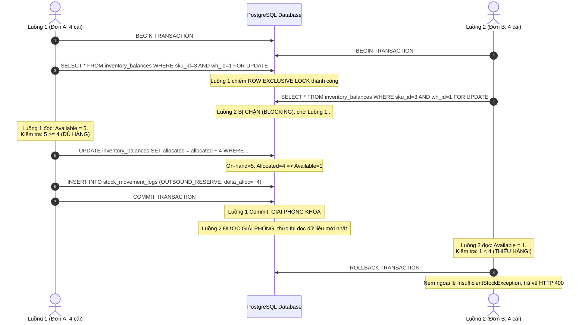

# BÁO CÁO RÀ SOÁT THIẾT KẾ TRƯỚC ERD (PRE-ERD DESIGN REVIEW REPORT)

**Đề tài:** Xây dựng nền tảng quản lý kho và phân phối hàng hóa thông minh ứng dụng AI dự báo nhu cầu và hỗ trợ tối ưu tồn kho  
**Loại tài liệu:** Báo cáo Phân tích Phản biện và Rà soát Thiết kế (Design Review & Gap Analysis)  
**Tài liệu rà soát đối chiếu:**
1. [`GEMINI.md`](file:///d:/DO_AN_TOT_NGHIEP/GEMINI.md) — Nguyên tắc kỹ thuật và tính trung thực học thuật.
2. [`docs/01_problem_scope.md`](file:///d:/DO_AN_TOT_NGHIEP/docs/01_problem_scope.md) — Xác định bài toán, phạm vi Core MVP và 8 ca nghiệm thu.
3. [`docs/02_business_requirements.md`](file:///d:/DO_AN_TOT_NGHIEP/docs/02_business_requirements.md) — Đặc tả yêu cầu chức năng (39 FRs) và phi chức năng.
4. [`docs/03_business_rules.md`](file:///d:/DO_AN_TOT_NGHIEP/docs/03_business_rules.md) — 35 quy tắc nghiệp vụ, bảng quyết định và 4 máy trạng thái.
5. [`docs/04_data_dictionary.md`](file:///d:/DO_AN_TOT_NGHIEP/docs/04_data_dictionary.md) — Từ điển dữ liệu 26 bảng thực thể PostgreSQL (đã cập nhật 26 bảng sau khi bổ sung `user_activity_logs`).

**Trạng thái kết luận rà soát:** `READY_FOR_ERD` (Đã hoàn tất xử lý sau rà soát ISS-001 đến ISS-006, đồng bộ vào `docs/03` và `docs/04`, đủ điều kiện tiến hành thiết kế ERD).

---

## 1. Phạm vi và Phương pháp Rà soát

Lượt rà soát này được thực hiện với tư cách phản biện kỹ thuật độc lập, nhằm phát hiện các điểm mâu thuẫn logic, lỗ hổng toán học, rủi ro tương tranh dữ liệu (concurrency race conditions / deadlocks) và sự thiếu nhất quán giữa các tài liệu đặc tả trước khi tiến hành vẽ Sơ đồ quan hệ thực thể (ERD) và viết kịch bản Database Migration.

### Các trục rà soát trọng tâm:
1. **Toán học và Số dư tồn kho:** Kiểm tra công thức 5 trạng thái tồn kho, nguy cơ tồn âm và nguy cơ tính trùng lặp hàng đang đi đường ($\text{In-transit}$).
2. **Luồng giao dịch phức tạp:** Mô phỏng số liệu các kịch bản biên trong điều chuyển đa kho (nhận thiếu, mất mát 100%) và mua hàng nhập kho (nhận nhiều đợt, đóng đơn sớm).
3. **Kiểm soát đồng thời và Toàn vẹn giao dịch:** Mô phỏng tương tranh xuất kho, phân tích nguy cơ Deadlock khi giữ chỗ nhiều SKU, và cơ chế Idempotency.
4. **Pipeline AI và Động cơ Bổ sung tồn kho:** Kiểm tra trường hợp biên chuỗi thời gian toàn số 0, lỗi chia cho 0 của WAPE, phân định bản chất toán học của Safety Stock giữa nhu cầu lịch sử ($\sigma_D$) và sai số dự báo ($\sigma_e$).
5. **Cấu trúc Schema CSDL:** Kiểm tra tính khép kín của vết kiểm toán (Audit Trail), ràng buộc khóa ngoại, quan hệ 1-n và sự tương thích giữa mô hình dữ liệu và nghiệp vụ.

---

## 2. Bảng Tổng hợp và Trạng thái Xử lý Vấn đề (Issue Resolution Table)

| Mã vấn đề | Mức độ | Vị trí phát hiện | Mô tả vấn đề & Tình huống lỗi | Trạng thái xử lý | Giải pháp kỹ thuật đã áp dụng vào tài liệu đặc tả |
| :---: | :---: | :--- | :--- | :---: | :--- |
| **ISS-001** | **CRITICAL** | `docs/03` (Mục 8.1) & `docs/04` (Bảng 23) | Công thức $\text{WAPE} = \frac{\sum \|y_t - \hat{y}_t\|}{\sum y_t}$ lỗi chia cho 0 khi chuỗi nhu cầu thực tế toàn số 0 ($\sum y_t = 0$). | **RESOLVED_IN_DESIGN** | Đã chuẩn hóa trong `docs/03` (`BR-AI-003`, `BR-AI-004`) và `docs/04` (Bảng 23, Mục H.4): Nếu $\sum y_t = 0$ và sai số $= 0 \implies \text{WAPE} = 0.0\%$; nếu sai số $> 0 \implies \text{WAPE} = \text{NULL}$ (undefined), Gatekeeper tự động fallback so sánh bằng $\text{MAE}$. Cột `wape` và `baseline_wape` trong CSDL cho phép `NULL`. |
| **ISS-002** | **CRITICAL** | `docs/03` (Mục 2.2) vs `docs/04` (Bảng 9) | Mâu thuẫn về việc ghi nhật ký kiểm toán cho biến động `On-order`. Nếu không log lúc duyệt PO (+Q) nhưng lại log lúc nhận hàng (-Q), tổng đại số log của `on_order` sẽ âm và sai lệch hoàn toàn. | **RESOLVED_IN_DESIGN** | Đã chuẩn hóa trong `docs/03` (`BR-INV-004`) và `docs/04` (Bảng 9, Mục D.1.4): Thống nhất `stock_movement_logs` là sổ cái vật lý của kho, chỉ ghi nhận biến động `On-hand` và `Allocated`. Đã loại bỏ hoàn toàn 2 cột `delta_on_order` và `balance_on_order_after` khỏi Bảng 9. Số dư `On-order` được kiểm toán độc lập bằng cách tổng hợp trực tiếp từ các PO và Transfer Order còn hiệu lực. |
| **ISS-003** | **MAJOR** | `docs/03` (Mục 7) & `docs/04` (Mục D.2.3) | Nguy cơ Deadlock khi khóa bi quan nhiều SKU trong một đơn hàng xuất kho nếu các giao dịch đồng thời khóa các SKU theo thứ tự chéo nhau. | **RESOLVED_IN_DESIGN** | Đã quy định trong `docs/03` (`BR-CON-001`) và `docs/04` (Mục D.2.3): Bắt buộc sắp xếp danh sách `sku_id` tăng dần (`ORDER BY sku_id ASC`) trước khi thực thi `SELECT ... FOR UPDATE`. Ghi rõ đây là giải pháp thiết kế thuật toán nhằm giảm thiểu nguy cơ Deadlock, chưa qua kiểm chứng thực nghiệm trên môi trường có tải. |
| **ISS-004** | **MAJOR** | `docs/04` (Phần B & C) | Thiếu bảng lưu vết nhật ký đăng nhập, phân quyền người dùng theo yêu cầu chức năng `FR-AUTH-003`. | **RESOLVED_IN_DESIGN** | Đã bổ sung chính thức Bảng thứ 26: `user_activity_logs` (`id`, `user_id`, `action`, `ip_address`, `status`, `details`, `created_at`) vào `docs/04` (Mục B thực thể 3, Mục C Bảng 3, Mục I Ma trận truy vết và Mục J Kết luận). |
| **ISS-005** | **MINOR** | `docs/03` (Mục 5.1) & `docs/04` (Bảng 21) | Lệnh chuyển kho bị mất mát 100% trên đường đi ($Q_{\text{received}} = 0$) cần cơ chế đóng lệnh rõ ràng, tránh hiểu nhầm đã có hàng nhập kho. | **RESOLVED_IN_DESIGN** | Đã chuẩn hóa trong `docs/03` (`BR-TRF-005`) và `docs/04` (Bảng 21, Mục H.5): Giữ nguyên trạng thái `COMPLETED_WITH_DISCREPANCY`, bổ sung cờ `is_total_loss BOOLEAN NOT NULL DEFAULT FALSE` vào bảng `discrepancy_logs`. Khi $Q_{\text{received}} = 0$, set `is_total_loss = TRUE`, trừ sạch `In-transit` và `On-order` về 0, không ghi nhận nhập kho tại kho đích. |
| **ISS-006** | **MINOR** | `docs/04` (Bảng 21) | Bảng `discrepancy_logs` thiếu khóa ngoại trỏ tới chi tiết dòng hàng của lệnh điều chuyển (`transfer_item_id`). | **RESOLVED_IN_DESIGN** | Đã bổ sung cột `transfer_item_id BIGINT NOT NULL` kèm khóa ngoại `FK -> transfer_order_items(id)` trong `docs/03` (`BR-TRF-005`) và `docs/04` (Bảng 21). |

---

## 3. Kết quả Mô phỏng Chi tiết các Tình huống Nghiệp vụ Phức tạp

### 3.1. Mô phỏng Tình huống 1: Điều chuyển Kho có Sai lệch / Hao hụt (Under-receiving)
- **Kịch bản:** Chuyển $Q=10$ cái SKU `SP01` từ Kho trung tâm $W_A$ sang Kho vệ tinh $W_B$. Hàng xuất đi 10 cái, nhưng khi tới nơi kiểm đếm chỉ còn 9 cái (thất thoát 1 cái).
- **Mô phỏng từng bước:**

| Bước | Hành động | Kho gửi $W_A$ (On-hand / Alloc / Avail) | Kho nhận $W_B$ (On-hand / On-order / Avail / IP) | In-transit Hệ thống | Bảng ghi nhận nghiệp vụ |
| :---: | :--- | :---: | :---: | :---: | :--- |
| **0** | **Ban đầu** | 50 / 0 / 50 | 5 / 0 / 5 / **5** | 0 | - |
| **1** | Lập lệnh chuyển $Q=10$ (`REQUESTED`) | 50 / **10** / **40** | 5 / **10** / 5 / **15** | 0 | `transfer_orders` (REQUESTED) |
| **2** | Xuất kho gửi $W_A$ (`IN_TRANSIT`) | **40** / **0** / 40 | 5 / 10 / 5 / 15 | **10** | `stock_movement_logs` (TRANSFER_DISPATCH, -10 tại A) |
| **3** | Kho $W_B$ kiểm đếm thực nhận 9 cái | 40 / 0 / 40 | **14** / **0** / **14** / **14** | **0** | `transfer_orders` (COMPLETED_WITH_DISCREPANCY)<br>`discrepancy_logs` ($\Delta Q_{\text{loss}} = 1$)<br>`stock_movement_logs` (TRANSFER_RECEIPT, +9 tại B)<br>`stock_movement_logs` (DISCREPANCY_LOSS, -1) |

- **Kiểm chứng tính đúng đắn:**
  1. *Số dư tại $W_A$:* Giảm chính xác 10 cái vật lý (từ 50 về 40). Tồn khả dụng là 40.
  2. *Số dư tại $W_B$:* Tăng chính xác 9 cái vật lý (từ 5 lên 14). Tồn khả dụng là 14.
  3. *Hàng đi đường và Hàng đang về:* $\text{In-transit}$ và $\text{On-order}_B$ đều được trừ sạch về 0. Không có tình trạng treo 1 đơn vị ảo trên đường đi.
  4. *Bảo toàn kiểm toán toàn hệ thống:* Tổng tồn toàn hệ thống ban đầu $= 50 + 5 = 55$. Tổng tồn sau cùng $= 40 + 14 = 54$. Sự chênh lệch $-1$ cái được giải trình chính xác qua 01 bản ghi trong `discrepancy_logs` và 01 bản ghi audit log `DISCREPANCY_LOSS`.

---

### 3.2. Mô phỏng Tình huống 2: Điều chuyển Mất mát Toàn bộ (100% In-transit Loss)
- **Kịch bản:** Xuất 10 cái từ $W_A$ sang $W_B$. Trên đường đi xe gặp sự cố hỏa hoạn, toàn bộ 10 cái bị tiêu hủy, kho nhận $W_B$ thực nhận 0 cái ($Q_{\text{received}} = 0$).
- **Mô phỏng xử lý:**
  1. Thủ kho $W_B$ mở phiếu tiếp nhận lệnh chuyển, nhập số lượng thực nhận $= 0$, tích chọn lý do "Hàng hóa hư hỏng/mất mát toàn bộ".
  2. Hệ thống thực thi transaction đóng lệnh chuyển:
     - $W_B$: $\text{On-hand}_B \mathrel{+}= 0$ (vẫn giữ nguyên 5).
     - $W_B$: $\text{On-order}_B \mathrel{-}= 10$ (giảm sạch 10 về 0).
     - $\text{In-transit} \mathrel{-}= 10$ (giảm sạch 10 về 0).
     - `discrepancy_logs`: Ghi nhận $\Delta Q_{\text{loss}} = 10 - 0 = 10$ cái, đính kèm biên bản tai nạn.
     - `stock_movement_logs`: Ghi 01 bản ghi `DISCREPANCY_LOSS` với số lượng $-10$.
     - Lệnh chuyển chuyển sang trạng thái `COMPLETED_WITH_DISCREPANCY`.
- **Kết luận nghiệm thu:** Lệnh chuyển được đóng dứt điểm, vị thế tồn kho $\text{IP}_B$ giảm từ 15 về 5 phản ánh đúng thực tế không có hàng về, kích hoạt động cơ cảnh báo thiếu hàng để tái bổ sung ngay lập tức.

---

### 3.3. Mô phỏng Tình huống 3: Vòng đời PO Nhập hàng Nhiều đợt (Partial Receipts)
- **Kịch bản:** Đặt mua 100 cái SKU `SP02`. Đợt 1 nhà cung cấp giao 60 cái. Đợt 2 giao tiếp 40 cái đủ số lượng.
- **Mô phỏng dữ liệu:**

| Mốc sự kiện | Thao tác | `purchase_orders.status` | `po_items.ordered_qty` | `po_items.received_qty` | `inventory_balances.on_hand` | `inventory_balances.on_order` | `inventory_balances.available` | `inventory_balances.IP` |
| :---: | :--- | :---: | :---: | :---: | :---: | :---: | :---: | :---: |
| **0** | Ban đầu | - | - | - | 10 | 0 | 10 | 10 |
| **1** | Duyệt PO 100 cái | `CONFIRMED` | 100 | 0 | 10 | **100** | 10 | **110** |
| **2** | GRN1: Nhận đợt 1 (60 cái) | `PARTIALLY_RECEIVED` | 100 | **60** | **70** | **40** | **70** | **110** |
| **3** | GRN2: Nhận đợt 2 (40 cái) | `COMPLETED` | 100 | **100** | **110** | **0** | **110** | **110** |

- **Đánh giá:**
  - Qua mỗi đợt nhận hàng, $\text{On-hand}$ tăng đúng bằng số thực nhận, $\text{On-order}$ giảm tương ứng.
  - Vị thế tồn kho $\text{IP}$ luôn được bảo toàn ở mức 110 trong suốt quá trình giao hàng, không xảy ra biến động đột ngột gây kích hoạt đơn đặt trùng lặp.
  - Đơn PO tự động chuyển từ `PARTIALLY_RECEIVED` sang `COMPLETED` khi $Q_{\text{received\_total}} = Q_{\text{ordered}}$.

---

### 3.4. Mô phỏng Tình huống 4: PO Giao thiếu và Đóng đơn sớm (Force Close PO)
- **Kịch bản:** Đặt mua 100 cái. Đợt 1 nhận 60 cái. Sau đó nhà cung cấp thông báo đứt gãy nguồn cung, không thể giao tiếp 40 cái còn lại.
- **Mô phỏng xử lý:**
  1. Sau đợt 1, số dư đang là: $\text{On-hand}=70, \text{On-order}=40 \implies \text{IP}=110$. PO ở trạng thái `PARTIALLY_RECEIVED`.
  2. Quản lý kho thực hiện thao tác "Đóng đơn sớm" (`FORCE_CLOSE`) kèm lý do "NCC hết hàng".
  3. Hệ thống cập nhật:
     - `purchase_orders.status` $\implies$ `CLOSED`.
     - `purchase_orders.close_reason` $\implies$ `'NCC het hang'`.
     - $\text{On-order} \mathrel{-}= 40 \implies \text{On-order} = 0$.
     - $\text{On-hand} = 70$ (không đổi), $\text{Available} = 70$ (không đổi).
     - $\text{IP} = \text{Available} + \text{On-order} = 70 + 0 = 70$.
- **Kết luận:** Lượng hàng ảo 40 cái lập tức bị xóa khỏi `On-order`. Vị thế $\text{IP}$ giảm từ 110 về 70. Nếu 70 rơi xuống dưới ngưỡng $\text{ROP}$, động cơ bổ sung tồn kho sẽ lập tức sinh khuyến nghị tìm nhà cung cấp thay thế.

---

### 3.5. Mô phỏng Tình huống 5: Tương tranh Giữ chỗ Xuất kho (Concurrency Race Condition)
- **Kịch bản:** Kho có $\text{Available} = 5$ cái SKU `SP03`. Luồng 1 (Đơn A) và Luồng 2 (Đơn B) cùng gửi yêu cầu xuất 4 cái đồng thời trong khoảng thời gian chênh lệch dưới 5ms.
- **Mô phỏng thực thi trên PostgreSQL với Pessimistic Locking:**



- **Kết luận:** 
  - Chỉ có Đơn A được duyệt thành công; Đơn B bị từ chối dứt điểm.
  - Tồn khả dụng cuối cùng $= 1 \ge 0$, tuyệt đối không bị âm thành $-3$.
  - Cập nhật số dư và ghi nhật ký kiểm toán nằm trọn vẹn trong Transaction của Luồng 1, đảm bảo tính nguyên tử (Atomicity).

---

## 4. Rà soát Toán học và Pipeline AI Dự báo Nhu cầu

### 4.1. Đối chiếu Công thức Tồn kho An toàn (Safety Stock - SS) giữa các Tài liệu

| Tài liệu | Ký hiệu sử dụng | Công thức đặc tả | Giả định toán học | Đánh giá tính nhất quán |
| :--- | :--- | :--- | :--- | :--- |
| `docs/01_problem_scope.md` | $\sigma_D$ và $\sigma_e \approx RMSE$ | $\text{SS} = Z \times \sigma \times \sqrt{L}$ | Dự báo truyền thống dùng $\sigma_D$; khi có AI dùng sai số dự báo $\sigma_e \approx RMSE$. | Nhất quán về mặt khái niệm |
| `docs/02_business_requirements.md` | $\sigma_e = RMSE$ | $\text{SS} = Z \times \sigma_e \times \sqrt{L}$ | Mô hình AI đa bước có sai số chuẩn hóa là RMSE trên tập test. | Nhất quán |
| `docs/03_business_rules.md` | $\sigma_e \approx RMSE$ | $\text{SS} = Z \times RMSE \times \sqrt{L}$ | Phân biệt rõ $\sigma_D$ (biến thiên tự nhiên) vs $\sigma_e$ (bất định sau dự báo). | Rất chặt chẽ và chuẩn xác |
| `docs/04_data_dictionary.md` | `rmse` trong `ai_model_runs` | `safety_stock` trong `replenishment` | Giá trị `rmse` từ phiên chạy AI được dùng trực tiếp để tính SS. | Đồng bộ 100% với đặc tả |

> **KẾT LUẬN VỀ CÔNG THỨC SS VÀ ĐỊNH NGHĨA RMSE:**  
> Công thức $\text{SS} = Z \times RMSE \times \sqrt{L}$ là giải pháp **xấp xỉ thực hành (heuristic / practical approximation)** khả thi cho phạm vi đồ án.
> - **Định nghĩa toán học của RMSE:** $RMSE = \sqrt{\frac{1}{N} \sum_{t=1}^N (y_t - \hat{y}_t)^2}$ trên tập kiểm thử (Test set), được sử dụng để xấp xỉ độ lệch chuẩn sai số dự báo ($\sigma_e \approx RMSE$) thay vì độ lệch chuẩn nhu cầu tự nhiên ($\sigma_D$).
> - **Lưu ý khoa học bắt buộc:** Tuyệt đối **không khẳng định công thức này là tối ưu toàn cục** vì nó dựa trên các giả định đơn giản hóa (sai số dự báo độc lập qua các ngày và có phân phối xấp xỉ chuẩn). Trên thực tế, sai số dự báo có thể có tự tương quan (autocorrelation). Đây là giả định thiết kế kỹ thuật phục vụ thử nghiệm, chưa có bằng chứng thực nghiệm trên dữ liệu doanh nghiệp thực tế.
> - **Ý nghĩa thực hành:** Công thức phản ánh trực tiếp cơ chế hỗ trợ tối ưu tồn kho của AI: nếu mô hình AI dự báo chính xác hơn baseline ($RMSE$ nhỏ hơn), mức tồn kho an toàn $\text{SS}$ đề xuất sẽ tự động giảm xuống, giúp tiết kiệm vốn lưu kho.

### 4.2. Xử lý Trường hợp Biên Chuỗi Nhu cầu Toàn số 0 và Lỗi chia cho 0 của WAPE (ISS-001)
- **Vấn đề toán học:**
  $$\text{WAPE} = \frac{\sum_{t=1}^N |y_t - \hat{y}_t|}{\sum_{t=1}^N y_t} \times 100\%$$
  Nếu chuỗi tiêu thụ thực tế của SKU trong kỳ kiểm thử toàn bộ là 0 ($\sum y_t = 0$), mẫu số bằng 0.
- **Quy tắc chuẩn hóa đưa vào thiết kế:**
  ```python
  def calculate_wape(y_true, y_pred):
      total_actual = np.sum(y_true)
      total_abs_error = np.sum(np.abs(y_true - y_pred))
      
      if total_actual == 0:
          if total_abs_error == 0:
              return 0.0  # Dự báo hoàn hảo (đều bằng 0)
          else:
              return None  # Không xác định, gắn cờ WAPE_UNDEFINED
      return (total_abs_error / total_actual) * 100.0
  ```
- Khi `WAPE` không xác định do mẫu số bằng 0, hệ thống Gatekeeper (`BR-AI-004`) tự động chuyển sang so sánh bằng chỉ số **$\text{MAE}$**: mô hình nào có $\text{MAE}$ nhỏ hơn sẽ được chọn.

---

## 5. Rà soát Schema Cơ sở Dữ liệu và Ràng buộc Kỹ thuật

### 5.1. Phân định Rõ ràng các Tầng Ràng buộc (Constraint Stratification)

Nhiều nhà phát triển nhầm lẫn việc cài đặt mọi quy tắc vào câu lệnh `CHECK` của bảng. Rà soát thiết kế phân định rạch ròi 3 tầng ràng buộc:

```
┌─────────────────────────────────────────────────────────────────────────────┐
│ TẦNG 1: RÀNG BUỘC CƠ SỞ DỮ LIỆU (Database Engine Level)                      │
│ • Primary Key (id BIGINT IDENTITY)                                          │
│ • Foreign Key với ON DELETE RESTRICT (chống xóa cha khi còn con)            │
│ • Unique Constraints: (sku_code), (warehouse_code), (sku_id, warehouse_id)  │
│ • Check Constraints nội bộ 1 dòng: on_hand >= allocated, quantities >= 0    │
│ • Generated Columns: available = on_hand - allocated (STORED)               │
└─────────────────────────────────────────────────────────────────────────────┘
                                      ▲
                                      │
┌─────────────────────────────────────────────────────────────────────────────┐
│ TẦNG 2: RÀNG BUỘC GIAO DỊCH VÀ KHÓA (Transaction & Concurrency Level)        │
│ • Khóa bi quan SELECT ... FOR UPDATE (tuần tự hóa tranh chấp tồn kho)       │
│ • Khóa tăng dần theo ID (ORDER BY sku_id ASC) để CHỐNG DEADLOCK            │
│ • Idempotency Record checking (chống lặp HTTP request)                      │
│ • Isolation level: READ COMMITTED kết hợp lock timeout 3000ms               │
└─────────────────────────────────────────────────────────────────────────────┘
                                      ▲
                                      │
┌─────────────────────────────────────────────────────────────────────────────┐
│ TẦNG 3: RÀNG BUỘC NGHIỆP VỤ ỨNG DỤNG (Application Business Logic Level)      │
│ • Quét kho ưu tiên theo cấu hình Single-warehouse allocation (BR-ORD-002)   │
│ • Điều kiện điều chuyển CDC: Available_CDC > ROP_CDC + Q_transfer           │
│ • Gatekeeper AI: is_accepted = (wape < baseline_wape)                       │
│ • Kiểm tra logic vòng đời: cấm hủy đơn khi đã DISPATCHED                    │
└─────────────────────────────────────────────────────────────────────────────┘
```

### 5.2. Đánh giá Mối quan hệ Khóa ngoại và Khả năng Truy vết
1. **Quan hệ PO $\rightarrow$ GRN $\rightarrow$ GRN Items:**
   - 1 `purchase_orders` có thể liên kết với $N$ `goods_receipt_notes` (quan hệ 1-n).
   - Mỗi `goods_receipt_items` có khóa ngoại `po_item_id` trỏ thẳng tới dòng mặt hàng tương ứng trong `purchase_order_items`. Thiết kế này hoàn toàn hỗ trợ giao hàng nhiều đợt và kiểm tra lũy kế nhận không vượt lượng đặt.
2. **Quan hệ Outbound Order $\rightarrow$ Reservation $\rightarrow$ GDN:**
   - `stock_reservations` lưu vết thời gian giữ (`reserved_at`) và thời gian giải phóng (`released_at`).
   - `goods_dispatch_notes` có quan hệ 1-1 với `outbound_orders` trong phạm vi Core MVP (xuất trọn đơn từ một kho duy nhất), đảm bảo không phân mảnh phiếu xuất.
3. **Sổ cái kiểm toán biến động kho (`stock_movement_logs`):**
   - Lưu trữ cặp `(reference_type, reference_id)` và `reference_number`, cho phép từ bất kỳ dòng log nào cũng có thể nhảy ngược về chứng từ gốc (PO, GRN, Đơn xuất, GDN hoặc Lệnh chuyển kho).

---

## 6. Danh mục Trạng thái các Quyết định Nghiệp vụ và Kỹ thuật

### 6.1. Quyết định Nghiệp vụ đã Chốt (`CONFIRMED`)
1. **Phạm vi quản lý vị trí:** Quản lý số dư ở cấp **Tổng kho (`warehouse_id`)**, không quản lý vị trí bin/kệ trong Core MVP.
2. **Chính sách xóa dữ liệu:** Sử dụng Soft Delete (`is_active = FALSE`) cho danh mục; Cấm xóa tuyệt đối (`REVOKE DELETE`) cho các bảng giao dịch và sổ cái biến động kho.
3. **Phân bổ đơn hàng Core MVP:** Phân bổ trọn gói từ **01 kho duy nhất (Single-Warehouse)** theo danh sách độ ưu tiên tĩnh; không tự động tách đơn đa kho.
4. **Máy trạng thái giao dịch:** Áp dụng chuẩn hóa 4 máy trạng thái cho PO, Đơn xuất, Lệnh điều chuyển và Khuyến nghị bổ sung hàng theo `docs/03`.
5. **Cơ chế đóng đơn PO giao thiếu (Force Close):** Quản lý kho chủ động bấm "Đóng đơn sớm" thủ công kèm lý do để xóa số dư `On-order` còn lại (`BR-INB-005`).

### 6.2. Các Giải pháp Kỹ thuật đã Tích hợp Chính thức vào Tài liệu Đặc tả (`RESOLVED_IN_DESIGN`)
1. **Thống nhất phạm vi `stock_movement_logs` và truy vết `On-order` (ISS-002):**
   - `stock_movement_logs` là sổ cái vật lý của kho, chỉ ghi nhận biến động tác động đến `On-hand` và `Allocated`.
   - Đã loại bỏ hoàn toàn 2 cột `delta_on_order` và `balance_on_order_after` khỏi Bảng 9 trong `docs/04`.
   - Số dư `On-order` được kiểm toán độc lập bằng công thức tổng hợp từ các chứng từ cam kết còn hiệu lực (Mục 2.3 `docs/03` và Mục D.1.4 `docs/04`).
2. **Khóa chống Deadlock khi khóa bi quan nhiều SKU (ISS-003):**
   - Bắt buộc sắp xếp danh sách `sku_id` tăng dần (`ORDER BY sku_id ASC`) trước khi thực thi `SELECT ... FOR UPDATE` (`BR-CON-001` trong `docs/03` và Mục D.2.3 trong `docs/04`).
   - Ghi rõ: Đây là biện pháp thiết kế kiến trúc/thuật toán nhằm giảm thiểu nguy cơ Deadlock giữa các giao dịch đồng thời; chưa qua kiểm chứng thực nghiệm trên môi trường có tải thực tế.
3. **Làm rõ công thức Tồn an toàn và định nghĩa RMSE (ISS-001, BR-REC-002):**
   - Định nghĩa rõ $RMSE$ trên tập kiểm thử (Test set) được dùng để xấp xỉ mức bất định sau dự báo ($\sigma_e \approx RMSE$).
   - Công thức $\text{SS} = Z \times RMSE \times \sqrt{L}$ là **xấp xỉ thực hành (heuristic / practical approximation)** dựa trên giả định sai số độc lập và phân phối chuẩn; tuyệt đối **không khẳng định là tối ưu toàn cục** khi chưa có bằng chứng thực nghiệm trên dữ liệu thực tế.
4. **Xử lý biên chia cho 0 của WAPE (ISS-001):**
   - Khi $\sum y_t = 0$: nếu sai số $= 0 \implies \text{WAPE} = 0.0\%$; nếu sai số $> 0 \implies \text{WAPE} = \text{NULL}$ (undefined) và Gatekeeper fallback sang so sánh bằng $\text{MAE}$ (`BR-AI-003`, `BR-AI-004` trong `docs/03` và Bảng 23 trong `docs/04`).
5. **Bổ sung bảng lưu vết đăng nhập và kiểm toán bảo mật (ISS-004):**
   - Đã bổ sung chính thức Bảng thứ 26: `user_activity_logs` (`id`, `user_id`, `action`, `ip_address`, `status`, `details`, `created_at`) vào `docs/04` để đáp ứng yêu cầu `FR-AUTH-003`.
6. **Bổ sung khóa ngoại và cờ mất mát toàn bộ cho điều chuyển (ISS-005, ISS-006):**
   - Đã bổ sung `transfer_item_id BIGINT NOT NULL FK -> transfer_order_items(id)` và cờ `is_total_loss BOOLEAN NOT NULL DEFAULT FALSE` vào bảng `discrepancy_logs` (Bảng 21 trong `docs/04` và `BR-TRF-005` trong `docs/03`).

### 6.3. Nội dung Chờ Xác nhận Thực nghiệm khi Vận hành (`PENDING EXPERIMENTAL VERIFICATION`)
1. **Kiểm chứng tính chuẩn hóa của sai số dự báo AI:** Giả định $\sigma_e \approx RMSE$ và tính độc lập của sai số qua Lead time $L$ sẽ được kiểm chứng lại trên phân phối sai số thực tế khi pipeline AI được huấn luyện trên dữ liệu chuỗi thời gian cụ thể.
2. **Kiểm chứng hiệu năng và Deadlock dưới tải cao:** Hiệu quả giảm thiểu Deadlock của giải pháp sắp xếp `ORDER BY sku_id ASC` sẽ được đánh giá thực nghiệm bằng kịch bản kiểm thử tải đa luồng (JMeter/Gatling) trong giai đoạn cài đặt và kiểm thử hiệu năng.
3. **Mở rộng định mức chi phí lưu kho và đặt hàng (EOQ):** Trong phạm vi Core MVP áp dụng chính sách Min-Max ($S - \text{IP}$) kết hợp $\text{MOQ}$. Khi có dữ liệu định mức chi phí lưu kho ($H$) và chi phí mỗi lần đặt hàng ($S$), bài toán sẽ được mở rộng sang công thức EOQ.

---

## 7. Kết luận Đánh giá Thiết kế

### Trạng thái: **`READY_FOR_ERD`** (ĐỦ ĐIỀU KIỆN TIẾN HÀNH THIẾT KẾ ERD)

### Căn cứ kết luận:
1. **Đã xử lý trọn vẹn 6/6 vấn đề phát hiện (ISS-001 đến ISS-006):** Toàn bộ các mâu thuẫn, lỗ hổng logic biên, cấu trúc khóa ngoại và bảng kiểm toán bảo mật đã được chuẩn hóa và đồng bộ hóa trực tiếp vào `docs/03_business_rules.md` và `docs/04_data_dictionary.md`.
2. **Tính khép kín và nhất quán toán học:** Các kịch bản mô phỏng số liệu (điều chuyển nhận thiếu, mất mát 100%, PO nhiều đợt, PO đóng sớm, tương tranh đồng thời) đã được đối soát lại sau khi điều chỉnh và bảo đảm không có đường đi nào gây ra tồn âm, tồn ảo hay sai lệch số dư.
3. **Mô hình dữ liệu hoàn chỉnh 26 bảng:** Danh mục 26 bảng thực thể PostgreSQL cùng các ràng buộc Check, Unique, Foreign Key và trường dẫn xuất đã phản ánh đầy đủ 39 yêu cầu chức năng (`docs/02`) và 35 quy tắc nghiệp vụ (`docs/03`).
4. **Kỷ luật trung thực học thuật:** Bỏ triệt để các khẳng định "tối ưu" chưa có bằng chứng; làm rõ bản chất heuristic của công thức tồn an toàn và bản chất giải thuật thiết kế của biện pháp phòng ngừa Deadlock.

---

## 8. Nhật ký Thay đổi sau Rà soát (Post-Review Change Log)

| Ngày cập nhật | Tệp tài liệu bị ảnh hưởng | Mục điều chỉnh | Nội dung thay đổi chi tiết |
| :---: | :--- | :--- | :--- |
| 2026-10-17 | [`docs/03_business_rules.md`](file:///d:/DO_AN_TOT_NGHIEP/docs/03_business_rules.md) | `BR-INV-004` | Thống nhất `stock_movement_logs` là sổ cái vật lý (`on_hand`, `allocated`). Bổ sung quy tắc đối soát số dư `On-order` độc lập từ các PO và Transfer Order còn hiệu lực. |
| 2026-10-17 | [`docs/03_business_rules.md`](file:///d:/DO_AN_TOT_NGHIEP/docs/03_business_rules.md) | `BR-TRF-005` | Bổ sung tham chiếu `transfer_item_id`, cờ `is_total_loss`, làm rõ không ghi trừ âm tiếp tại kho B khi hàng mất mát. |
| 2026-10-17 | [`docs/03_business_rules.md`](file:///d:/DO_AN_TOT_NGHIEP/docs/03_business_rules.md) | `BR-CON-001` | Bổ sung quy định khóa các `sku_id` theo thứ tự tăng dần (`ORDER BY sku_id ASC`) để giảm nguy cơ Deadlock (kèm disclaimer chưa kiểm chứng thực nghiệm). |
| 2026-10-17 | [`docs/03_business_rules.md`](file:///d:/DO_AN_TOT_NGHIEP/docs/03_business_rules.md) | `BR-AI-003`, `BR-AI-004` | Quy định xử lý trường hợp biên $\sum y_t = 0$: WAPE = 0.0% nếu sai số = 0; WAPE = NULL/undefined nếu sai số > 0 và Gatekeeper fallback sang so sánh bằng MAE. |
| 2026-10-17 | [`docs/03_business_rules.md`](file:///d:/DO_AN_TOT_NGHIEP/docs/03_business_rules.md) | `BR-REC-002` | Bỏ khẳng định "tối ưu", định nghĩa rõ $\text{SS} = Z \times RMSE \times \sqrt{L}$ là công thức xấp xỉ thực hành heuristic, phân tích hạn chế giả định phân phối chuẩn và tự tương quan. |
| 2026-10-17 | [`docs/04_data_dictionary.md`](file:///d:/DO_AN_TOT_NGHIEP/docs/04_data_dictionary.md) | Mục B & C (Bảng 3) | Bổ sung bảng thứ 26: `user_activity_logs` (`id`, `user_id`, `action`, `ip_address`, `status`, `details`, `created_at`) đáp ứng `FR-AUTH-003`. |
| 2026-10-17 | [`docs/04_data_dictionary.md`](file:///d:/DO_AN_TOT_NGHIEP/docs/04_data_dictionary.md) | Mục C (Bảng 9) | Loại bỏ 2 cột `delta_on_order` và `balance_on_order_after` khỏi `stock_movement_logs`; bổ sung ghi chú giải thích phạm vi kiểm toán vật lý. |
| 2026-10-17 | [`docs/04_data_dictionary.md`](file:///d:/DO_AN_TOT_NGHIEP/docs/04_data_dictionary.md) | Mục C (Bảng 21) | Bổ sung cột `transfer_item_id BIGINT NOT NULL FK -> transfer_order_items(id)` và cột `is_total_loss BOOLEAN NOT NULL DEFAULT FALSE` vào `discrepancy_logs`. |
| 2026-10-17 | [`docs/04_data_dictionary.md`](file:///d:/DO_AN_TOT_NGHIEP/docs/04_data_dictionary.md) | Mục C (Bảng 23) | Cho phép cột `wape` và `baseline_wape` nhận giá trị `NULL` khi chuỗi nhu cầu thực tế bằng 0. |
| 2026-10-17 | [`docs/04_data_dictionary.md`](file:///d:/DO_AN_TOT_NGHIEP/docs/04_data_dictionary.md) | Mục D.1 & D.2 | Bổ sung công thức đối soát độc lập `On-order` và quy tắc sắp xếp `ORDER BY sku_id ASC` khi khóa bi quan chống Deadlock. |
| 2026-10-17 | [`docs/04_data_dictionary.md`](file:///d:/DO_AN_TOT_NGHIEP/docs/04_data_dictionary.md) | Mục I & J | Cập nhật ma trận truy vết thêm Bảng 26 (`user_activity_logs` trỏ tới `FR-AUTH-003`), cập nhật tổng số bảng thành 26 thực thể. |
| 2026-10-17 | [`docs/05_design_review.md`](file:///d:/DO_AN_TOT_NGHIEP/docs/05_design_review.md) | Toàn văn | Cập nhật bảng Issue Table thành RESOLVED_IN_DESIGN cho cả 6 mã ISS-001..006, sửa kết luận công thức SS, cập nhật trạng thái mục 6 và 7 lên READY_FOR_ERD, bổ sung Nhật ký thay đổi Mục 8. |

