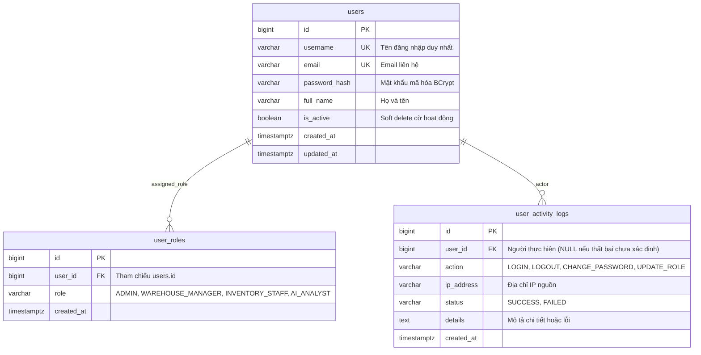
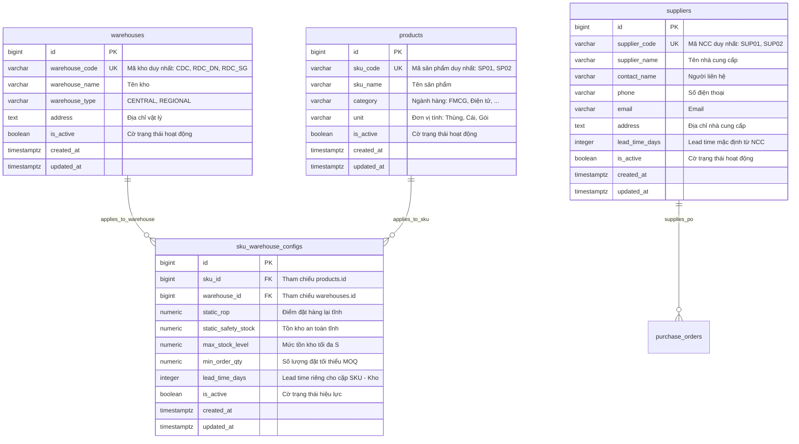
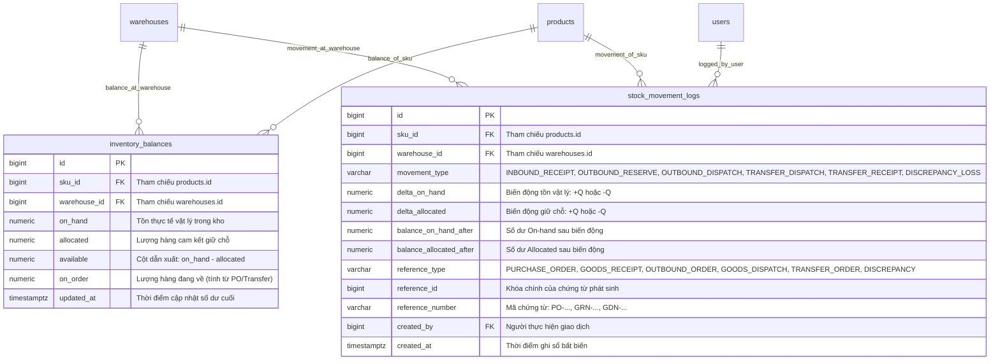
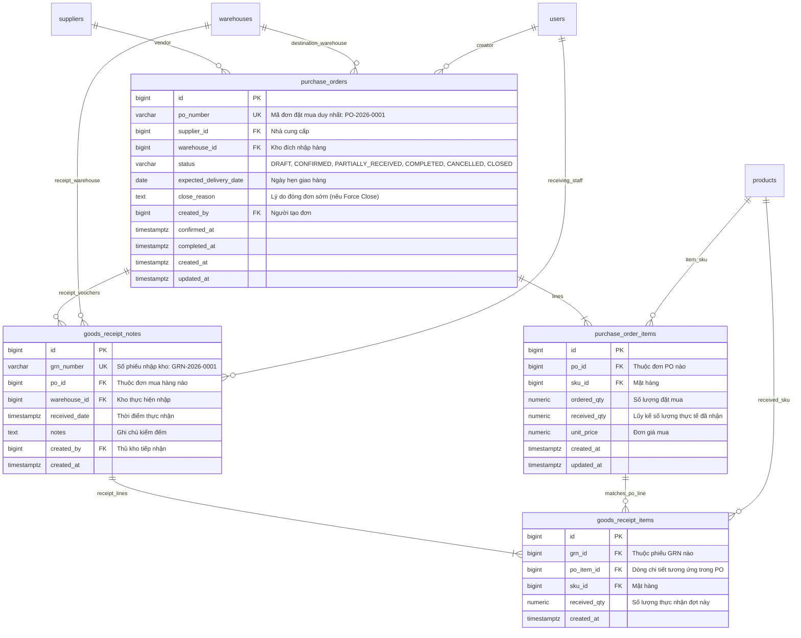
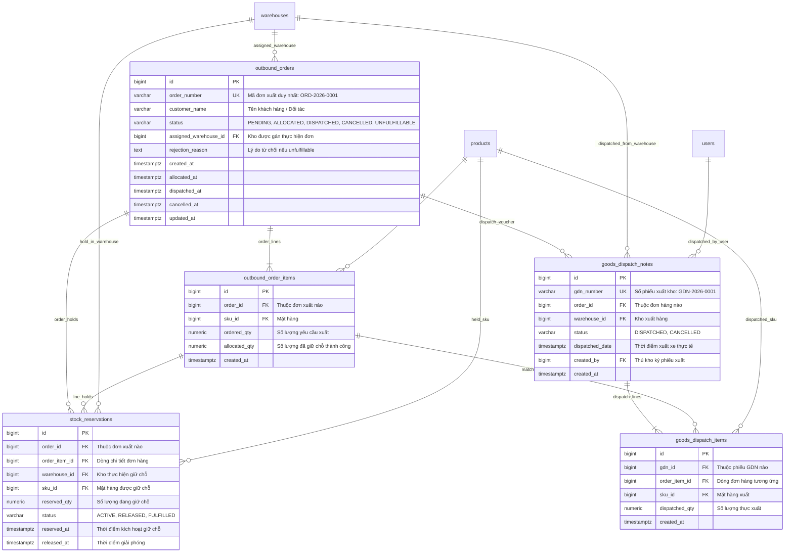
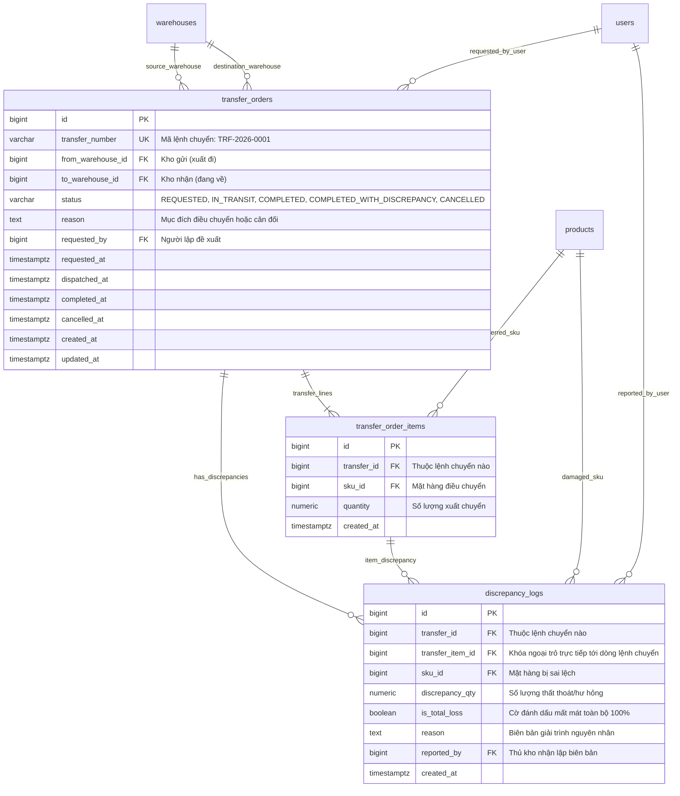
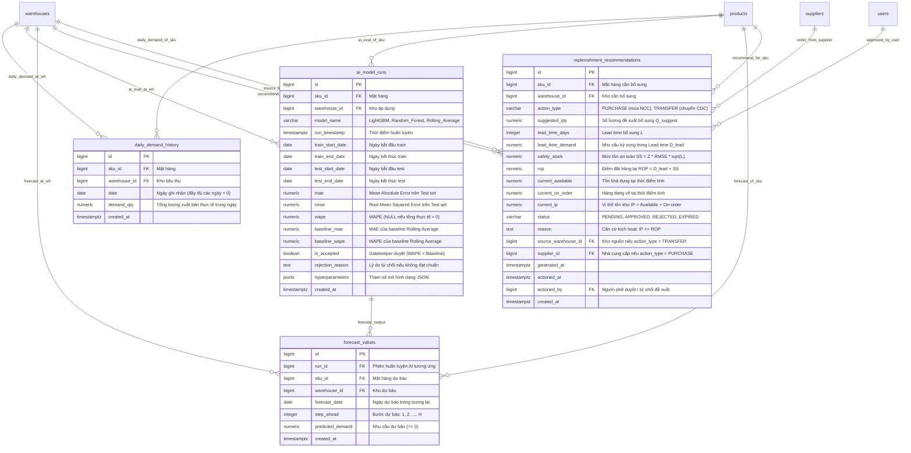
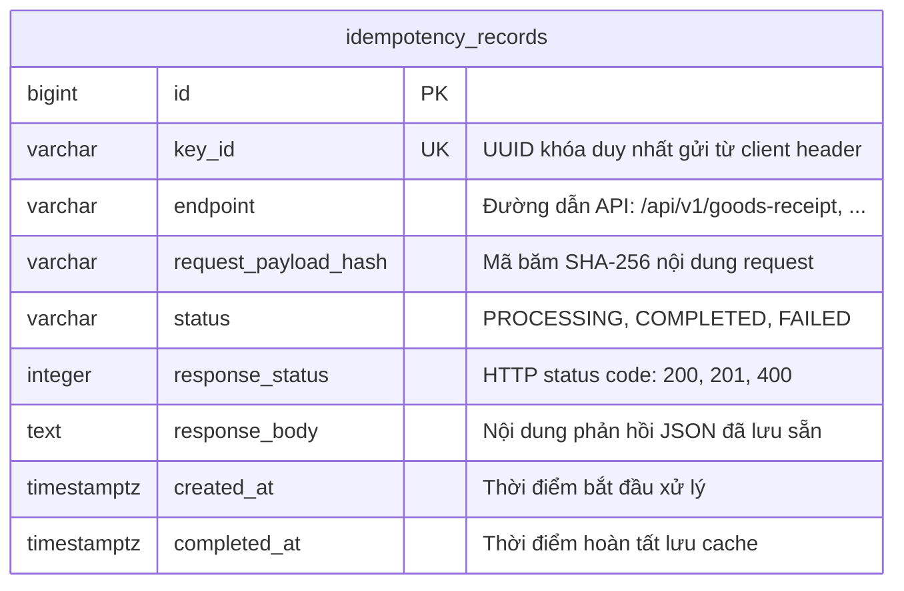

# THIẾT KẾ SƠ ĐỒ QUAN HỆ THỰC THỂ (ENTITY RELATIONSHIP DIAGRAM - ERD)

**Đề tài:** Xây dựng nền tảng quản lý kho và phân phối hàng hóa thông minh ứng dụng AI dự báo nhu cầu và hỗ trợ tối ưu tồn kho  
**Loại tài liệu:** Thiết kế Cơ sở Dữ liệu Quan hệ & Sơ đồ Thực thể (Database Architecture & ERD Specification)  
**Trạng thái tài liệu:** Bản thiết kế chính thức (Official Database Design)  
**Môi trường triển khai mục tiêu:** PostgreSQL 16+ / Java 21 Spring Boot / Python FastAPI  
**Tài liệu tham chiếu nền tảng:**
1. [`GEMINI.md`](file:///d:/DO_AN_TOT_NGHIEP/GEMINI.md) — Kỷ luật kỹ thuật, chuẩn mực trung thực và minh bạch học thuật.
2. [`docs/01_problem_scope.md`](file:///d:/DO_AN_TOT_NGHIEP/docs/01_problem_scope.md) — Định vị bài toán, phạm vi Core MVP và 8 ca nghiệm thu.
3. [`docs/02_business_requirements.md`](file:///d:/DO_AN_TOT_NGHIEP/docs/02_business_requirements.md) — Đặc tả 39 yêu cầu chức năng (FR) và phi chức năng (NFR).
4. [`docs/03_business_rules.md`](file:///d:/DO_AN_TOT_NGHIEP/docs/03_business_rules.md) — 35 quy tắc nghiệp vụ, bảng quyết định và 4 máy trạng thái giao dịch.
5. [`docs/04_data_dictionary.md`](file:///d:/DO_AN_TOT_NGHIEP/docs/04_data_dictionary.md) — Từ điển dữ liệu chuẩn hóa 26 bảng thực thể.
6. [`docs/05_design_review.md`](file:///d:/DO_AN_TOT_NGHIEP/docs/05_design_review.md) — Báo cáo rà soát thiết kế và kết quả xử lý dứt điểm các mã `ISS-001` đến `ISS-006`.

---

## Phần 1. Rà soát và Làm rõ 4 Điểm Kỹ thuật Tiên quyết trước ERD

Trước khi chuyển đổi mô hình dữ liệu thành các sơ đồ quan hệ thực thể, 4 vấn đề kỹ thuật mấu chốt được xác lập chuẩn hóa và kiểm chứng tính nhất quán như sau:

### 1.1. Định nghĩa Chính xác Trạng thái Chứng từ Đối soát `On-order`
Số dư `On-order` đại diện cho khối lượng hàng hóa đã cam kết mua từ nhà cung cấp hoặc đang trong quá trình điều chuyển nội bộ về kho nhận, nhưng chưa nhập vào tồn kho vật lý (`On-hand`).

- **Phạm vi tính toán:** Xác định duy nhất theo từng cặp `(warehouse_id, sku_id)` tại thời điểm truy vấn $T$.
- **Tập trạng thái chứng từ nguồn được đưa vào đối soát:**
  1. **Đơn mua hàng từ Nhà cung cấp (`purchase_orders`):**
     - Chỉ lấy các đơn PO có trạng thái: `CONFIRMED` (đã duyệt, NCC chưa giao) hoặc `PARTIALLY_RECEIVED` (đang nhận dở dang từng đợt).
     - Số lượng cam kết còn lại của từng mặt hàng: $\Delta Q_{\text{PO}} = \text{ordered\_qty} - \text{received\_qty}$.
     - *Xử lý nhận hàng từng phần:* Khi tạo phiếu nhập kho (`goods_receipt_notes`), trường `received_qty` trong `purchase_order_items` tăng lên $\implies (\text{ordered\_qty} - \text{received\_qty})$ tự động giảm tương ứng $\implies$ Số dư `On-order` giảm đúng bằng lượng thực nhận.
     - *Xử lý hoàn tất:* Khi $\text{received\_qty} = \text{ordered\_qty}$, PO chuyển sang `COMPLETED`, tự động rời khỏi tập đối soát $\implies \Delta Q_{\text{PO}} = 0$.
     - *Xử lý hủy đơn / đóng đơn sớm (Force Close):* Khi PO bị hủy (`CANCELLED`) hoặc đóng sớm do NCC đứt hàng (`CLOSED` theo `BR-INB-005`), PO lập tức rời khỏi tập đối soát $\implies$ lượng hàng cam kết còn lại bị xóa dứt điểm khỏi `On-order`, vị thế tồn kho $\text{IP}$ hạ về đúng thực tế.
  2. **Lệnh điều chuyển kho nội bộ (`transfer_orders`):**
     - Đối với **Kho nhận** (`to_warehouse_id`), chỉ lấy các lệnh chuyển có trạng thái: `REQUESTED` (đã lập lệnh, kho gửi chưa xuất) hoặc `IN_TRANSIT` (kho gửi đã xuất, hàng đang đi đường).
     - Số lượng cam kết: $\Delta Q_{\text{TRF}} = \text{quantity}$ (từ `transfer_order_items`).
     - *Xử lý hủy lệnh:* Khi lệnh chuyển ở `REQUESTED` bị hủy (`CANCELLED`), lệnh rời khỏi tập đối soát $\implies$ `On-order` của kho nhận giảm về 0.
     - *Xử lý hoàn tất điều chuyển (Full / Partial / Discrepancy):* Khi kho nhận xác nhận nhận hàng, lệnh chuyển chuyển sang `COMPLETED` (nếu đủ) hoặc `COMPLETED_WITH_DISCREPANCY` (nếu thiếu hoặc mất mát). Cả 2 trạng thái này đều nằm ngoài tập đối soát $\implies$ toàn bộ số lượng lệnh chuyển được trừ sạch khỏi `On-order` của kho nhận; đồng thời kho nhận tăng `On-hand` theo đúng số lượng thực nhận $Q_{\text{received}}$.
- **Công thức truy vấn đối soát độc lập (Audit Reconciliation Query):**
  $$\text{On-order}_{\text{audit}}(\text{wh}, \text{sku}) = \sum_{\substack{\text{PO} \in \{\text{CONFIRMED}, \text{PARTIALLY\_RECEIVED}\} \\ \text{PO.wh\_id} = \text{wh}, \text{poi.sku\_id} = \text{sku}}} (\text{poi.ordered\_qty} - \text{poi.received\_qty}) + \sum_{\substack{\text{TRF} \in \{\text{REQUESTED}, \text{IN\_TRANSIT}\} \\ \text{TRF.to\_wh\_id} = \text{wh}, \text{toi.sku\_id} = \text{sku}}} \text{toi.quantity}$$

---

### 1.2. Chuẩn hóa Quy tắc Đánh giá Mô hình khi WAPE Không xác định (Undefined WAPE)
Chỉ số sai số tỷ lệ trọng số $\text{WAPE} = \frac{\sum_{t=1}^N |y_t - \hat{y}_t|}{\sum_{t=1}^N y_t} \times 100\%$ gặp trường hợp biên khi tập kiểm thử của SKU bán chậm có tổng nhu cầu thực tế bằng 0 ($\sum_{t=1}^N y_t = 0$).

Quy tắc chuẩn hóa 4 trường hợp biên đưa vào thiết kế hệ thống và CSDL:
1. **Trường hợp 1 (Dự báo hoàn hảo bằng 0):** Cả nhu cầu thực tế và dự báo đều bằng 0 ($\sum |y_t - \hat{y}_t| = 0$). Hệ thống ghi nhận $\text{WAPE} = 0.0\%$. Mô hình được đánh giá đạt chuẩn.
2. **Trường hợp 2 (Mẫu số bằng 0, có sai số dự báo):** Tổng thực tế bằng 0 nhưng dự báo $> 0$ ($\sum |y_t - \hat{y}_t| > 0$). Giá trị $\text{WAPE}$ toán học là không xác định. Trong bảng `ai_model_runs`, trường `wape` được lưu giá trị `NULL`.
3. **Quy tắc Fallback của Gatekeeper (`BR-AI-004`):** Khi một trong hai mô hình (Candidate hoặc Baseline) có `WAPE = NULL`, Gatekeeper tự động chuyển sang so sánh bằng chỉ số **$\text{MAE}$ (Mean Absolute Error)**:
   $$\text{Mô hình Candidate được nghiệm thu} \iff \text{MAE}_{\text{candidate}} < \text{MAE}_{\text{baseline}}$$
4. **Trường hợp cả Candidate và Baseline đều có $\text{MAE}$ bằng nhau:** Ưu tiên chọn Baseline truyền thống (Rolling 7-day Moving Average) theo nguyên lý tiết kiệm tham số (Parsimony) để giảm tải tính toán suy luận.

---

### 1.3. Phân biệt RMSE Đánh giá Dự báo với Sai số Ước lượng Tồn an toàn (Safety Stock)
Để tuân thủ nghiêm ngặt chuẩn mực trung thực khoa học tại [`GEMINI.md`](file:///d:/DO_AN_TOT_NGHIEP/GEMINI.md), thiết kế phân định rạch ròi hai khái niệm:
1. **$\text{RMSE}_{\text{eval}}$ (Chỉ số đánh giá độ chính xác mô hình AI):**
   $$\text{RMSE}_{\text{eval}} = \sqrt{\frac{1}{N} \sum_{t=1}^N (y_t - \hat{y}_t)^2} \quad (\text{đơn vị: sản phẩm/ngày})$$
   Đo lường độ lệch chuẩn mẫu của phần dư dự báo trên tập kiểm thử (Test set). Mục đích: đánh giá chất lượng mô hình, so sánh thuật toán, phát hiện overfitting.
2. **$\sigma_{\text{lead}}$ (Độ biến thiên sai số trong thời gian bổ sung hàng $L$ ngày):**
   Về mặt lý thuyết xác suất, biến động nhu cầu trong $L$ ngày là độ lệch chuẩn của tổng sai số: $\sigma_{\text{lead}} = \sqrt{Var\left(\sum_{k=1}^L e_{t+k}\right)}$.
3. **Bản chất của Công thức Xấp xỉ Thực hành (Heuristic / Practical Approximation):**
   Trong thiết kế hệ thống, công thức tính tồn an toàn đề xuất:
   $$\text{SS} = Z \times \text{RMSE} \times \sqrt{L}$$
   - **Giả định đơn giản hóa:** Giả định sai số dự báo $e_t$ giữa các ngày độc lập với nhau ($Cov(e_i, e_j) = 0$) và có phân phối xấp xỉ chuẩn Gauss.
   - **Tuyên bố minh bạch:** **Không tuyên bố công thức này là tối ưu toàn cục**. Trên dữ liệu chuỗi thời gian thực tế, sai số dự báo đa bước thường xuất hiện tự tương quan (autocorrelation). Tuy nhiên, đây là giải pháp xấp xỉ thực hành khả thi và có ý nghĩa nghiệp vụ cao nhất cho đồ án: khi mô hình AI cải thiện độ chính xác ($\text{RMSE}$ giảm), mức tồn kho an toàn $\text{SS}$ tự động giảm xuống so với khi dùng độ lệch chuẩn nhu cầu tự nhiên $\sigma_D$, phản ánh giá trị hỗ trợ tối ưu vốn lưu kho của AI.

---

### 1.4. Đề xuất Thứ tự Khóa Tồn kho Thống nhất `(warehouse_id, sku_id)` Chống Deadlock
Trong các giao dịch tương tranh phức tạp (như giữ chỗ đơn hàng đa mặt hàng, hoặc điều chuyển kho tác động đồng thời đến Kho gửi $W_A$ và Kho nhận $W_B$):
- **Nguy cơ Deadlock:** Nếu Giao dịch 1 khóa Kho $A$ rồi chờ khóa Kho $B$, trong khi Giao dịch 2 khóa Kho $B$ rồi chờ khóa Kho $A$, hệ thống rơi vào khóa chéo (Cyclic Deadlock).
- **Quy tắc giải thuật bắt buộc (Lexicographical Locking Order):**
  Mọi giao dịch cần thao tác khóa bi quan (`SELECT ... FOR UPDATE`) trên bảng `inventory_balances` bắt buộc phải sắp xếp danh sách tài nguyên theo thứ tự tăng dần của cặp khóa:
  $$\text{ORDER BY warehouse\_id ASC, sku\_id ASC}$$
  - *Ví dụ Điều chuyển:* Chuyển hàng từ Kho 5 sang Kho 2 cho SKU 10. Luồng xử lý BẮT BUỘC phải khóa bản ghi `(warehouse_id = 2, sku_id = 10)` trước, sau đó mới khóa `(warehouse_id = 5, sku_id = 10)`. Mọi luồng khác liên quan đến Kho 2 và Kho 5 đều tuân thủ thứ tự $2 \to 5$, triệt tiêu chu trình chờ đợi ngược chiều.
- **Giới hạn và Yêu cầu Kiểm thử Thực nghiệm:** Đây là giải pháp thiết kế thuật toán nhằm giảm thiểu nguy cơ Deadlock lý thuyết. Hiệu năng thực tế, độ trễ chờ khóa và tỷ lệ Lock Timeout (3000ms theo `BR-CON-001`) phải được kiểm chứng thực nghiệm bằng kịch bản kiểm thử tải đa luồng đồng thời trong giai đoạn triển khai mã nguồn.

---

## Phần A. Sơ đồ ERD Tổng thể (Master ERD)

Sơ đồ ERD tổng thể dưới đây bao gồm đầy đủ **26 thực thể** cơ sở dữ liệu đã chuẩn hóa 3NF, thể hiện trọn vẹn các mối quan hệ khóa ngoại (Foreign Key) và tính liên kết logic giữa các phân hệ:

```mermaid
erDiagram
    %% ==========================================
    %% NHÓM 1: HỆ THỐNG & NGƯỜI DÙNG
    %% ==========================================
    users ||--o{ user_roles : "has"
    users ||--o{ user_activity_logs : "performs"
    users ||--o{ purchase_orders : "creates"
    users ||--o{ goods_receipt_notes : "creates"
    users ||--o{ goods_dispatch_notes : "creates"
    users ||--o{ transfer_orders : "requests"
    users ||--o{ discrepancy_logs : "reports"
    users ||--o{ replenishment_recommendations : "actions"

    %% ==========================================
    %% NHÓM 2: DANH MỤC CƠ SỞ (MASTER DATA)
    %% ==========================================
    warehouses ||--o{ sku_warehouse_configs : "configures"
    warehouses ||--o{ inventory_balances : "stores"
    warehouses ||--o{ stock_movement_logs : "records"
    warehouses ||--o{ purchase_orders : "receives_at"
    warehouses ||--o{ goods_receipt_notes : "receives_in"
    warehouses ||--o{ outbound_orders : "fulfills_from"
    warehouses ||--o{ goods_dispatch_notes : "dispatches_from"
    warehouses ||--o{ stock_reservations : "reserves_in"
    warehouses ||--o{ transfer_orders : "dispatches_from"
    warehouses ||--o{ transfer_orders : "receives_at"
    warehouses ||--o{ daily_demand_history : "aggregates"
    warehouses ||--o{ ai_model_runs : "evaluates"
    warehouses ||--o{ forecast_values : "forecasts_for"
    warehouses ||--o{ replenishment_recommendations : "recommends_for"

    suppliers ||--o{ purchase_orders : "supplies"
    suppliers ||--o{ replenishment_recommendations : "suggests_supplier"

    products ||--o{ sku_warehouse_configs : "configures"
    products ||--o{ inventory_balances : "tracks"
    products ||--o{ stock_movement_logs : "logs"
    products ||--o{ purchase_order_items : "contains"
    products ||--o{ goods_receipt_items : "contains"
    products ||--o{ outbound_order_items : "contains"
    products ||--o{ stock_reservations : "reserves"
    products ||--o{ goods_dispatch_items : "contains"
    products ||--o{ transfer_order_items : "contains"
    products ||--o{ discrepancy_logs : "reports_loss"
    products ||--o{ daily_demand_history : "records_demand"
    products ||--o{ ai_model_runs : "trains_for"
    products ||--o{ forecast_values : "forecasts_for"
    products ||--o{ replenishment_recommendations : "recommends_for"

    %% ==========================================
    %% NHÓM 4: NHẬP KHO (INBOUND)
    %% ==========================================
    purchase_orders ||--|{ purchase_order_items : "has_lines"
    purchase_orders ||--o{ goods_receipt_notes : "fulfilled_by"
    goods_receipt_notes ||--|{ goods_receipt_items : "has_lines"
    purchase_order_items ||--o{ goods_receipt_items : "receipt_line_of"

    %% ==========================================
    %% NHÓM 5: XUẤT KHO (OUTBOUND)
    %% ==========================================
    outbound_orders ||--|{ outbound_order_items : "has_lines"
    outbound_orders ||--o{ stock_reservations : "holds"
    outbound_order_items ||--o{ stock_reservations : "reserves_line"
    outbound_orders ||--o{ goods_dispatch_notes : "fulfilled_by"
    goods_dispatch_notes ||--|{ goods_dispatch_items : "has_lines"
    outbound_order_items ||--o{ goods_dispatch_items : "dispatch_line_of"

    %% ==========================================
    %% NHÓM 6: ĐIỀU CHUYỂN KHO (TRANSFER)
    %% ==========================================
    transfer_orders ||--|{ transfer_order_items : "has_lines"
    transfer_orders ||--o{ discrepancy_logs : "has_loss_events"
    transfer_order_items ||--o{ discrepancy_logs : "identifies_loss_line"

    %% ==========================================
    %% NHÓM 7: AI & DỰ BÁO & BỔ SUNG TỒN KHO
    %% ==========================================
    ai_model_runs ||--o{ forecast_values : "produces"

    %% ==========================================
    %% ĐẶC TẢ THỰC THỂ CHI TIẾT
    %% ==========================================
    users {
        bigint id PK
        varchar username UK
        varchar email UK
        varchar password_hash
        varchar full_name
        boolean is_active
        timestamptz created_at
        timestamptz updated_at
    }

    user_roles {
        bigint id PK
        bigint user_id FK
        varchar role
        timestamptz created_at
    }

    user_activity_logs {
        bigint id PK
        bigint user_id FK
        varchar action
        varchar ip_address
        varchar status
        text details
        timestamptz created_at
    }

    warehouses {
        bigint id PK
        varchar warehouse_code UK
        varchar warehouse_name
        varchar warehouse_type
        text address
        boolean is_active
        timestamptz created_at
        timestamptz updated_at
    }

    suppliers {
        bigint id PK
        varchar supplier_code UK
        varchar supplier_name
        varchar contact_name
        varchar phone
        varchar email
        text address
        integer lead_time_days
        boolean is_active
        timestamptz created_at
        timestamptz updated_at
    }

    products {
        bigint id PK
        varchar sku_code UK
        varchar sku_name
        varchar category
        varchar unit
        boolean is_active
        timestamptz created_at
        timestamptz updated_at
    }

    sku_warehouse_configs {
        bigint id PK
        bigint sku_id FK
        bigint warehouse_id FK
        numeric static_rop
        numeric static_safety_stock
        numeric max_stock_level
        numeric min_order_qty
        integer lead_time_days
        boolean is_active
        timestamptz created_at
        timestamptz updated_at
    }

    inventory_balances {
        bigint id PK
        bigint sku_id FK
        bigint warehouse_id FK
        numeric on_hand
        numeric allocated
        numeric available
        numeric on_order
        timestamptz updated_at
    }

    stock_movement_logs {
        bigint id PK
        bigint sku_id FK
        bigint warehouse_id FK
        varchar movement_type
        numeric delta_on_hand
        numeric delta_allocated
        numeric balance_on_hand_after
        numeric balance_allocated_after
        varchar reference_type
        bigint reference_id
        varchar reference_number
        bigint created_by FK
        timestamptz created_at
    }

    purchase_orders {
        bigint id PK
        varchar po_number UK
        bigint supplier_id FK
        bigint warehouse_id FK
        varchar status
        date expected_delivery_date
        text close_reason
        bigint created_by FK
        timestamptz confirmed_at
        timestamptz completed_at
        timestamptz created_at
        timestamptz updated_at
    }

    purchase_order_items {
        bigint id PK
        bigint po_id FK
        bigint sku_id FK
        numeric ordered_qty
        numeric received_qty
        numeric unit_price
        timestamptz created_at
        timestamptz updated_at
    }

    goods_receipt_notes {
        bigint id PK
        varchar grn_number UK
        bigint po_id FK
        bigint warehouse_id FK
        timestamptz received_date
        text notes
        bigint created_by FK
        timestamptz created_at
    }

    goods_receipt_items {
        bigint id PK
        bigint grn_id FK
        bigint po_item_id FK
        bigint sku_id FK
        numeric received_qty
        timestamptz created_at
    }

    outbound_orders {
        bigint id PK
        varchar order_number UK
        varchar customer_name
        varchar status
        bigint assigned_warehouse_id FK
        text rejection_reason
        timestamptz created_at
        timestamptz allocated_at
        timestamptz dispatched_at
        timestamptz cancelled_at
        timestamptz updated_at
    }

    outbound_order_items {
        bigint id PK
        bigint order_id FK
        bigint sku_id FK
        numeric ordered_qty
        numeric allocated_qty
        timestamptz created_at
    }

    stock_reservations {
        bigint id PK
        bigint order_id FK
        bigint order_item_id FK
        bigint warehouse_id FK
        bigint sku_id FK
        numeric reserved_qty
        varchar status
        timestamptz reserved_at
        timestamptz released_at
    }

    goods_dispatch_notes {
        bigint id PK
        varchar gdn_number UK
        bigint order_id FK
        bigint warehouse_id FK
        varchar status
        timestamptz dispatched_date
        bigint created_by FK
        timestamptz created_at
    }

    goods_dispatch_items {
        bigint id PK
        bigint gdn_id FK
        bigint order_item_id FK
        bigint sku_id FK
        numeric dispatched_qty
        timestamptz created_at
    }

    transfer_orders {
        bigint id PK
        varchar transfer_number UK
        bigint from_warehouse_id FK
        bigint to_warehouse_id FK
        varchar status
        text reason
        bigint requested_by FK
        timestamptz requested_at
        timestamptz dispatched_at
        timestamptz completed_at
        timestamptz cancelled_at
        timestamptz created_at
        timestamptz updated_at
    }

    transfer_order_items {
        bigint id PK
        bigint transfer_id FK
        bigint sku_id FK
        numeric quantity
        timestamptz created_at
    }

    discrepancy_logs {
        bigint id PK
        bigint transfer_id FK
        bigint transfer_item_id FK
        bigint sku_id FK
        numeric discrepancy_qty
        boolean is_total_loss
        text reason
        bigint reported_by FK
        timestamptz created_at
    }

    daily_demand_history {
        bigint id PK
        bigint sku_id FK
        bigint warehouse_id FK
        date date
        numeric demand_qty
        timestamptz created_at
    }

    ai_model_runs {
        bigint id PK
        bigint sku_id FK
        bigint warehouse_id FK
        varchar model_name
        timestamptz run_timestamp
        date train_start_date
        date train_end_date
        date test_start_date
        date test_end_date
        numeric mae
        numeric rmse
        numeric wape
        numeric baseline_mae
        numeric baseline_wape
        boolean is_accepted
        text rejection_reason
        jsonb hyperparameters
        timestamptz created_at
    }

    forecast_values {
        bigint id PK
        bigint run_id FK
        bigint sku_id FK
        bigint warehouse_id FK
        date forecast_date
        integer step_ahead
        numeric predicted_demand
        timestamptz created_at
    }

    replenishment_recommendations {
        bigint id PK
        bigint sku_id FK
        bigint warehouse_id FK
        varchar action_type
        numeric suggested_qty
        integer lead_time_days
        numeric lead_time_demand
        numeric safety_stock
        numeric rop
        numeric current_available
        numeric current_on_order
        numeric current_ip
        varchar status
        text reason
        bigint source_warehouse_id FK
        bigint supplier_id FK
        timestamptz generated_at
        timestamptz actioned_at
        bigint actioned_by FK
        timestamptz created_at
    }

    idempotency_records {
        bigint id PK
        varchar key_id UK
        varchar endpoint
        varchar request_payload_hash
        varchar status
        integer response_status
        text response_body
        timestamptz created_at
        timestamptz completed_at
    }
```



---

## Phần B. Các Sơ đồ ERD Chi tiết theo 8 Nhóm Phân hệ

### Nhóm 1: Người dùng, Phân quyền và Nhật ký Hoạt động (Users & Security Audit)
Nhóm thực thể quản lý danh tính người dùng, kiểm soát truy cập dựa trên vai trò (RBAC) và lưu vết kiểm toán bảo mật theo yêu cầu `FR-AUTH-001`, `FR-AUTH-002`, `FR-AUTH-003`.



---

### Nhóm 2: Danh mục Cơ sở, Kho, Nhà Cung Cấp và Cấu hình Tồn kho (Master Data & Policies)
Quản lý danh mục sản phẩm, cấu trúc mạng lưới kho đa điểm (CDC, RDC), hồ sơ nhà cung cấp và cấu hình ngưỡng tồn kho tĩnh theo `FR-MST-001` đến `FR-MST-004`.



---

### Nhóm 3: Tồn kho Hiện hành, Biến động Tồn và Giữ chỗ (Inventory Balances & Movements)
Phân hệ quản lý số dư thời gian thực và sổ cái biến động vật lý bất biến (Append-only Ledger) theo `FR-INV-001`, `FR-INV-002`, `FR-INV-003`, `FR-AUD-001`.



---

### Nhóm 4: Mua hàng và Nhập kho từ Nhà Cung Cấp (Purchase Orders & Goods Receipts)
Quản lý vòng đời đơn mua hàng và phiếu nhập kho GRN, hỗ trợ nhận hàng nhiều đợt và kiểm tra lũy kế nhận theo `FR-INB-001` đến `FR-INB-004`.



---

### Nhóm 5: Đơn Xuất Hàng, Giữ Chỗ và Phiếu Xuất (Outbound Orders, Reservations & Dispatches)
Quản lý chu trình phân bổ trọn gói từ một kho duy nhất (Single-Warehouse), khóa giữ chỗ bi quan và lập phiếu xuất kho GDN theo `FR-OUT-001` đến `FR-OUT-005` và `FR-ORD-001`.



---

### Nhóm 6: Điều Chuyển Kho và Sai Lệch Hàng Hóa (Transfer Orders & Discrepancies)
Quản lý chu trình điều chuyển kho 2 pha cách ly hàng đi đường (`In-transit`), ghi nhận biên bản thất thoát/sai lệch khi có sự cố giao thiếu theo `FR-TRF-001` đến `FR-TRF-005`.



---

### Nhóm 7: Dữ liệu Nhu cầu, Pipeline AI và Động cơ Bổ sung Tồn kho (AI Forecasting & Replenishment)
Tập hợp chuỗi thời gian tiêu thụ liên tục, nhật ký nghiệm thu mô hình học máy theo quy tắc Gatekeeper, kết quả dự báo đa bước và khuyến nghị bổ sung tự động theo `FR-AI-001` đến `FR-AI-004` và `FR-REC-001` đến `FR-REC-005`.



---

### Nhóm 8: Kiểm soát Kỹ thuật, Tương tranh và Idempotency (Technical & Concurrency Control)
Chống ghi nhận trùng lặp giao dịch (Double Submit) và bảo toàn tính toàn vẹn hệ thống theo `FR-AUD-002` và `BR-CON-003`.



---

## Phần C. Bảng Đặc tả Chi tiết Quan hệ, Cardinality, Khóa và Ràng buộc

Bảng tổng hợp chi tiết toàn bộ các mối quan hệ giữa 26 thực thể, chỉ rõ bản chất khóa chính (PK), khóa ngoại (FK), ràng buộc duy nhất (UNIQUE), tính tùy chọn và hành vi xử lý toàn vẹn:

| STT | Bảng Cha (Source) | Bảng Con (Target) | Khóa Ngoại (FK Field) | Cardinality | Khóa Duy nhất / Unique | Tính Tùy chọn (Optionality) | Hành vi Khóa ngoại (On Delete / On Update) | Mục đích Nghiệp vụ |
| :---: | :--- | :--- | :--- | :---: | :--- | :--- | :--- | :--- |
| **1** | `users` | `user_roles` | `user_id` | **1 — N** | `(user_id, role)` UK | Bắt buộc (Mandatory) | `ON DELETE CASCADE` | Một người dùng có thể đảm nhận một hoặc nhiều vai trò hệ thống. |
| **2** | `users` | `user_activity_logs` | `user_id` | **1 — N** | Không | Tùy chọn (`user_id` NULL nếu đăng nhập sai username) | `ON DELETE SET NULL` | Lưu vết nhật ký đăng nhập, đổi mật khẩu và phân quyền bảo mật. |
| **3** | `warehouses` | `sku_warehouse_configs` | `warehouse_id` | **1 — N** | `(sku_id, warehouse_id)` UK | Bắt buộc | `ON DELETE RESTRICT` | Thiết lập ngưỡng tồn kho tĩnh ($ROP, SS, S, MOQ$) cho từng kho. |
| **4** | `products` | `sku_warehouse_configs` | `sku_id` | **1 — N** | `(sku_id, warehouse_id)` UK | Bắt buộc | `ON DELETE RESTRICT` | Gắn sản phẩm với cấu hình tồn kho của từng kho cụ thể. |
| **5** | `warehouses` | `inventory_balances` | `warehouse_id` | **1 — N** | `(sku_id, warehouse_id)` UK | Bắt buộc | `ON DELETE RESTRICT` | Theo dõi số dư thời gian thực của các SKU tại từng kho. |
| **6** | `products` | `inventory_balances` | `sku_id` | **1 — N** | `(sku_id, warehouse_id)` UK | Bắt buộc | `ON DELETE RESTRICT` | Quản lý số dư tồn kho chi tiết theo từng mã sản phẩm. |
| **7** | `warehouses` | `stock_movement_logs` | `warehouse_id` | **1 — N** | Không | Bắt buộc | `ON DELETE RESTRICT` | Sổ cái kiểm toán bất biến ghi nhận mọi biến động vật lý tại kho. |
| **8** | `products` | `stock_movement_logs` | `sku_id` | **1 — N** | Không | Bắt buộc | `ON DELETE RESTRICT` | Ghi nhận chi tiết lịch sử tăng/giảm số dư của từng SKU. |
| **9** | `users` | `stock_movement_logs` | `created_by` | **1 — N** | Không | Tùy chọn (`created_by` NULL nếu giao dịch từ batch AI) | `ON DELETE RESTRICT` | Xác định nhân sự chịu trách nhiệm đối với từng giao dịch kho. |
| **10** | `suppliers` | `purchase_orders` | `supplier_id` | **1 — N** | Không | Bắt buộc | `ON DELETE RESTRICT` | Đơn mua hàng bắt buộc phải chỉ định một nhà cung cấp cụ thể. |
| **11** | `warehouses` | `purchase_orders` | `warehouse_id` | **1 — N** | Không | Bắt buộc | `ON DELETE RESTRICT` | Đơn mua hàng quy định rõ kho đích tiếp nhận hàng. |
| **12** | `users` | `purchase_orders` | `created_by` | **1 — N** | Không | Bắt buộc | `ON DELETE RESTRICT` | Người tạo lập đơn mua hàng. |
| **13** | `purchase_orders` | `purchase_order_items` | `po_id` | **1 — N** | `(po_id, sku_id)` UK | Bắt buộc (Mỗi PO phải có $\ge 1$ dòng) | `ON DELETE CASCADE` | Danh sách các mặt hàng chi tiết trong đơn đặt mua. |
| **14** | `products` | `purchase_order_items` | `sku_id` | **1 — N** | Không | Bắt buộc | `ON DELETE RESTRICT` | Sản phẩm trong từng dòng mua hàng. |
| **15** | `purchase_orders` | `goods_receipt_notes` | `po_id` | **1 — N** | Không | Bắt buộc (1 PO có thể có nhiều đợt GRN) | `ON DELETE RESTRICT` | Phiếu nhập kho GRN đối chiếu với đơn PO nguồn. |
| **16** | `warehouses` | `goods_receipt_notes` | `warehouse_id` | **1 — N** | Không | Bắt buộc | `ON DELETE RESTRICT` | Kho thực tế tiếp nhận và kiểm đếm lô hàng. |
| **17** | `users` | `goods_receipt_notes` | `created_by` | **1 — N** | Không | Bắt buộc | `ON DELETE RESTRICT` | Thủ kho thực hiện kiểm đếm và lập phiếu nhập. |
| **18** | `goods_receipt_notes` | `goods_receipt_items` | `grn_id` | **1 — N** | Không | Bắt buộc (Mỗi GRN có $\ge 1$ dòng) | `ON DELETE CASCADE` | Chi tiết số lượng thực nhận của từng mặt hàng trong đợt giao. |
| **19** | `purchase_order_items` | `goods_receipt_items` | `po_item_id` | **1 — N** | Không | Bắt buộc | `ON DELETE RESTRICT` | Khóa ngoại đối soát lũy kế nhận không vượt lượng đặt của dòng PO. |
| **20** | `products` | `goods_receipt_items` | `sku_id` | **1 — N** | Không | Bắt buộc | `ON DELETE RESTRICT` | Sản phẩm thực nhận trên phiếu nhập kho. |
| **21** | `warehouses` | `outbound_orders` | `assigned_warehouse_id` | **1 — N** | Không | Tùy chọn (NULL khi đơn mới tạo `PENDING` chưa phân bổ) | `ON DELETE RESTRICT` | Kho duy nhất được hệ thống gán thực hiện xuất trọn đơn. |
| **22** | `outbound_orders` | `outbound_order_items` | `order_id` | **1 — N** | `(order_id, sku_id)` UK | Bắt buộc (Mỗi đơn có $\ge 1$ dòng) | `ON DELETE CASCADE` | Danh sách các mặt hàng cần xuất trong đơn bán hàng. |
| **23** | `products` | `outbound_order_items` | `sku_id` | **1 — N** | Không | Bắt buộc | `ON DELETE RESTRICT` | Sản phẩm đặt mua trong đơn xuất kho. |
| **24** | `outbound_orders` | `stock_reservations` | `order_id` | **1 — N** | Không | Bắt buộc | `ON DELETE RESTRICT` | Ghi nhận các lệnh giữ chỗ phục vụ cho đơn hàng. |
| **25** | `outbound_order_items` | `stock_reservations` | `order_item_id` | **1 — N** | Không | Bắt buộc | `ON DELETE RESTRICT` | Giữ chỗ chi tiết cho từng dòng mặt hàng của đơn xuất. |
| **26** | `warehouses` | `stock_reservations` | `warehouse_id` | **1 — N** | Không | Bắt buộc | `ON DELETE RESTRICT` | Kho thực hiện cam kết giữ hàng tồn kho. |
| **27** | `products` | `stock_reservations` | `sku_id` | **1 — N** | Không | Bắt buộc | `ON DELETE RESTRICT` | Sản phẩm được cam kết giữ chỗ. |
| **28** | `outbound_orders` | `goods_dispatch_notes` | `order_id` | **1 — 1** | `(order_id)` UK | Bắt buộc (1 đơn trọn gói sinh 1 GDN duy nhất) | `ON DELETE RESTRICT` | Phiếu xuất kho chính thức hoàn tất đơn hàng. |
| **29** | `warehouses` | `goods_dispatch_notes` | `warehouse_id` | **1 — N** | Không | Bắt buộc | `ON DELETE RESTRICT` | Kho thực hiện đóng hàng và xuất xe. |
| **30** | `users` | `goods_dispatch_notes` | `created_by` | **1 — N** | Không | Bắt buộc | `ON DELETE RESTRICT` | Thủ kho phụ trách xuất hàng. |
| **31** | `goods_dispatch_notes` | `goods_dispatch_items` | `gdn_id` | **1 — N** | Không | Bắt buộc (Mỗi GDN có $\ge 1$ dòng) | `ON DELETE CASCADE` | Chi tiết số lượng hàng hóa thực xuất khỏi kho. |
| **32** | `outbound_order_items` | `goods_dispatch_items` | `order_item_id` | **1 — 1** | `(gdn_id, order_item_id)` UK | Bắt buộc | `ON DELETE RESTRICT` | Đối soát dòng xuất với dòng đơn hàng bán tương ứng. |
| **33** | `products` | `goods_dispatch_items` | `sku_id` | **1 — N** | Không | Bắt buộc | `ON DELETE RESTRICT` | Sản phẩm thực xuất trên phiếu xuất kho. |
| **34** | `warehouses` | `transfer_orders` | `from_warehouse_id` | **1 — N** | Không | Bắt buộc | `ON DELETE RESTRICT` | Kho gửi (xuất chuyển hàng đi). |
| **35** | `warehouses` | `transfer_orders` | `to_warehouse_id` | **1 — N** | Không | Bắt buộc | `ON DELETE RESTRICT` | Kho nhận (tiếp nhận hàng đến). |
| **36** | `users` | `transfer_orders` | `requested_by` | **1 — N** | Không | Bắt buộc | `ON DELETE RESTRICT` | Nhân viên lập đề xuất điều chuyển. |
| **37** | `transfer_orders` | `transfer_order_items` | `transfer_id` | **1 — N** | `(transfer_id, sku_id)` UK | Bắt buộc (Mỗi lệnh có $\ge 1$ dòng) | `ON DELETE CASCADE` | Danh sách mặt hàng và số lượng chuyển kho. |
| **38** | `products` | `transfer_order_items` | `sku_id` | **1 — N** | Không | Bắt buộc | `ON DELETE RESTRICT` | Sản phẩm trong lệnh điều chuyển nội bộ. |
| **39** | `transfer_orders` | `discrepancy_logs` | `transfer_id` | **1 — N** | Không | Bắt buộc | `ON DELETE RESTRICT` | Lệnh chuyển có sự cố hao hụt/thất thoát hàng. |
| **40** | `transfer_order_items` | `discrepancy_logs` | `transfer_item_id` | **1 — N** | Không | Bắt buộc | `ON DELETE RESTRICT` | **Khóa ngoại trỏ trực tiếp dòng chi tiết bị mất mát (ISS-006).** |
| **41** | `products` | `discrepancy_logs` | `sku_id` | **1 — N** | Không | Bắt buộc | `ON DELETE RESTRICT` | Sản phẩm bị phát hiện sai lệch thực nhận. |
| **42** | `users` | `discrepancy_logs` | `reported_by` | **1 — N** | Không | Bắt buộc | `ON DELETE RESTRICT` | Thủ kho nhận lập biên bản phát hiện sai lệch. |
| **43** | `warehouses` | `daily_demand_history` | `warehouse_id` | **1 — N** | `(sku_id, warehouse_id, date)` UK | Bắt buộc | `ON DELETE RESTRICT` | Kho ghi nhận nhu cầu tiêu thụ hàng ngày. |
| **44** | `products` | `daily_demand_history` | `sku_id` | **1 — N** | `(sku_id, warehouse_id, date)` UK | Bắt buộc | `ON DELETE RESTRICT` | Sản phẩm theo dõi chuỗi thời gian liên tục. |
| **45** | `warehouses` | `ai_model_runs` | `warehouse_id` | **1 — N** | Không | Bắt buộc | `ON DELETE RESTRICT` | Kho áp dụng mô hình dự báo AI. |
| **46** | `products` | `ai_model_runs` | `sku_id` | **1 — N** | Không | Bắt buộc | `ON DELETE RESTRICT` | Sản phẩm được huấn luyện và đánh giá dự báo. |
| **47** | `ai_model_runs` | `forecast_values` | `run_id` | **1 — N** | `(run_id, forecast_date)` UK | Bắt buộc | `ON DELETE CASCADE` | Kết quả dự báo đa bước sinh ra từ một phiên chạy AI. |
| **48** | `warehouses` | `forecast_values` | `warehouse_id` | **1 — N** | Không | Bắt buộc | `ON DELETE RESTRICT` | Kho dự báo nhu cầu tương lai. |
| **49** | `products` | `forecast_values` | `sku_id` | **1 — N** | Không | Bắt buộc | `ON DELETE RESTRICT` | Sản phẩm dự báo nhu cầu tương lai. |
| **50** | `warehouses` | `replenishment_recommendations` | `warehouse_id` | **1 — N** | Không | Bắt buộc | `ON DELETE RESTRICT` | Kho đích cần được bổ sung tồn kho. |
| **51** | `warehouses` | `replenishment_recommendations` | `source_warehouse_id` | **1 — N** | Không | Tùy chọn (Chỉ có giá trị khi `action_type = TRANSFER`) | `ON DELETE RESTRICT` | Kho trung tâm đóng vai trò nguồn điều chuyển. |
| **52** | `suppliers` | `replenishment_recommendations` | `supplier_id` | **1 — N** | Không | Tùy chọn (Chỉ có giá trị khi `action_type = PURCHASE`) | `ON DELETE RESTRICT` | Nhà cung cấp được khuyến nghị đặt mua hàng. |
| **53** | `products` | `replenishment_recommendations` | `sku_id` | **1 — N** | Không | Bắt buộc | `ON DELETE RESTRICT` | Sản phẩm được đề xuất bổ sung. |
| **54** | `users` | `replenishment_recommendations` | `actioned_by` | **1 — N** | Không | Tùy chọn (NULL khi đề xuất ở trạng thái `PENDING`) | `ON DELETE RESTRICT` | Quản lý kho phê duyệt hoặc bác bỏ đề xuất bổ sung. |

---

## Phần D. Phân loại Thực thể và Quản lý Số dư Tồn kho

Để bảo đảm tính minh bạch kiến trúc, 26 thực thể được phân loại thành 3 nhóm dữ liệu riêng biệt theo vòng đời và nguyên tắc biến động:

```
┌────────────────────────────────────────────────────────────────────────────────────────────────┐
│ PHÂN LOẠI 26 THỰC THỂ CƠ SỞ DỮ LIỆU                                                          │
├───────────────────────────────┬────────────────────────────────────────────────────────────────┤
│ 1. DỮ LIỆU NGHIỆP VỤ           │ • Master Data (Soft Delete): users, warehouses, suppliers,    │
│    (Stateful Business Data)   │   products, sku_warehouse_configs                             │
│                               │ • Operational State (Read-heavy / Pessimistic Locking):        │
│                               │   inventory_balances                                           │
│                               │ • Transaction Documents (State Machines): purchase_orders,     │
│                               │   purchase_order_items, goods_receipt_notes, goods_receipt_    │
│                               │   items, outbound_orders, outbound_order_items, stock_         │
│                               │   reservations, goods_dispatch_notes, goods_dispatch_items,    │
│                               │   transfer_orders, transfer_order_items, idempotency_records   │
├───────────────────────────────┼────────────────────────────────────────────────────────────────┤
│ 2. NHẬT KÝ BẤT BIẾN           │ • stock_movement_logs (Sổ cái kiểm toán biến động vật lý)      │
│    (Immutable Audit Ledger)   │ • discrepancy_logs (Nhật ký thất thoát, hư hỏng điều chuyển)   │
│    [APPEND-ONLY, NO UPDATE,   │ • user_activity_logs (Nhật ký truy cập, bảo mật người dùng)    │
│     NO DELETE]                │ • daily_demand_history (Chuỗi thời gian tiêu thụ lịch sử)      │
├───────────────────────────────┼────────────────────────────────────────────────────────────────┤
│ 3. KẾT QUẢ TÍNH TOÁN & AI     │ • ai_model_runs (Lịch sử phiên chạy huấn luyện & metrics)      │
│    (Computed / AI Artifacts)  │ • forecast_values (Giá trị dự báo nhu cầu đa bước H ngày)      │
│                               │ • replenishment_recommendations (Đề xuất đặt hàng / điều chuyển│
└───────────────────────────────┴────────────────────────────────────────────────────────────────┘
```

### Phân định Rõ ràng: Giá trị Lưu trữ Vật lý vs Giá trị Suy ra (Derived / Generated)

| Tên Trường | Bảng Thực thể | Bản chất Lưu trữ | Công thức Suy ra hoặc Cơ chế Cập nhật | Giải thích Kỹ thuật |
| :--- | :--- | :---: | :--- | :--- |
| `on_hand` | `inventory_balances` | **Lưu trữ vật lý** | Cập nhật qua giao dịch kho có kèm `SELECT ... FOR UPDATE` | Tồn vật lý thực tế trong kho. |
| `allocated` | `inventory_balances` | **Lưu trữ vật lý** | Cập nhật khi tạo/hủy giữ chỗ đơn hàng hoặc lệnh chuyển | Lượng hàng đã cam kết nội bộ. |
| `available` | `inventory_balances` | **Cột sinh tự động (STORED Generated Column)** | `available = (on_hand - allocated)` | PostgreSQL tự động tính toán và lưu trữ; cấm ứng dụng sửa trực tiếp trường này. |
| `on_order` | `inventory_balances` | **Lưu trữ vật lý (Fast Access)** | Đồng bộ qua Transaction khi duyệt PO, nhận GRN, lập Transfer | Lưu sẵn để phục vụ câu truy vấn quét nhanh vị thế tồn kho $\text{IP} \le \text{ROP}$. |
| `on_order_audit` | *(Không tạo cột)* | **Giá trị suy ra (Computed On-demand)** | $\sum (\text{PO}_{\text{ord}} - \text{PO}_{\text{rec}}) + \sum \text{TRF}_{\text{qty}}$ | Giá trị kiểm toán độc lập dùng để đối soát tính đúng đắn của trường `on_order`. |
| `IP` (Inventory Position) | *(Không tạo cột)* | **Giá trị suy ra (Runtime Expression)** | $\text{IP} = \text{available} + \text{on_order}$ | Tính toán động trong câu truy vấn của động cơ bổ sung tồn kho; không lưu bảng để tránh dư thừa dữ liệu. |
| `In-transit` | *(Không tạo cột)* | **Giá trị suy ra (Runtime Expression)** | $\sum_{\text{status} = \text{'IN\_TRANSIT'}} \text{transfer\_order\_items.quantity}$ | Tổng hợp từ các lệnh chuyển đang chạy trên đường; tuyệt đối không cộng vào `On-hand` của bất kỳ kho nào. |

---

## Phần E. Kiểm Chứng Tính Bất Biến Số Dư và Cách Ly Hàng Đi Đường

### 1. Quy tắc $\text{Available} = \text{On-hand} - \text{Allocated}$
- **Bất biến CSDL:** Cơ sở dữ liệu thiết lập ràng buộc toàn vẹn:
  ```sql
  CONSTRAINT chk_inventory_invariants CHECK (
      on_hand >= allocated AND
      on_hand >= 0 AND
      allocated >= 0
  );
  ```
- **Tính toán tự động:** Cột `available` được định nghĩa là Generated Column:
  ```sql
  available NUMERIC(12, 2) GENERATED ALWAYS AS (on_hand - allocated) STORED
  ```
  Nhờ ràng buộc $\text{on\_hand} \ge \text{allocated}$, giá trị $\text{available}$ luôn đảm bảo $\ge 0$, ngăn chặn triệt để hiện tượng tồn âm.

### 2. Quy tắc $\text{IP} = \text{Available} + \text{On-order}$ và Cách ly $\text{In-transit}$
- **Nguyên tắc vàng:** Hàng đang đi đường ($\text{In-transit}$) **tuyệt đối không được tính trùng lặp hai lần** vào vị thế tồn kho:
  1. Khi kho gửi xuất hàng đi: $\text{On-hand}_{\text{gửi}}$ giảm ngay lập tức $\implies$ hàng rời khỏi vị thế tồn kho của kho gửi.
  2. Tại kho nhận: Hàng chỉ xuất hiện duy nhất dưới dạng $\text{On-order}_{\text{nhận}}$, chưa hề xuất hiện trong $\text{On-hand}_{\text{nhận}}$ hay $\text{Available}_{\text{nhận}}$.
  3. Khi kho nhận kiểm đếm thực tế: $\text{On-order}_{\text{nhận}}$ giảm đi đúng bằng số lượng lệnh chuyển; đồng thời $\text{On-hand}_{\text{nhận}}$ tăng lên theo đúng số lượng thực nhận $Q_{\text{received}}$.
  4. Nếu có hao hụt $\Delta Q_{\text{loss}}$, lượng này bị tiêu hủy khỏi hệ thống thông qua `discrepancy_logs`, không bao giờ được chuyển thành $\text{On-hand}$, đảm bảo $\text{IP}_{\text{nhận}}$ phản ánh chính xác lượng hàng thực sự sẵn sàng đáp ứng.

---

## Phần F. Ma trận Truy vết Yêu cầu Nghiệp vụ (FR/NFR/BR Traceability Matrix) sang Bảng ERD

Bảng đối soát chứng minh tính đầy đủ và khép kín của 26 bảng ERD đối với toàn bộ các yêu cầu chức năng (39 FRs), phi chức năng (NFRs) và quy tắc nghiệp vụ (35 BRs):

| Phân hệ Nghiệp vụ | Mã Yêu cầu Chức năng (FR) | Mã Quy tắc Nghiệp vụ (BR) | Bảng Thực thể CSDL Đảm nhiệm | Vai trò của Bảng trong Yêu cầu |
| :--- | :--- | :--- | :--- | :--- |
| **Bảo mật & Phân quyền** | `FR-AUTH-001` (Đăng nhập JWT)<br>`FR-AUTH-002` (Phân quyền 4 vai trò)<br>`FR-AUTH-003` (Lưu vết đăng nhập/bảo mật) | - | • `users`<br>• `user_roles`<br>• `user_activity_logs` | Quản lý tài khoản, mã hóa mật khẩu BCrypt, ánh xạ vai trò RBAC và lưu vết nhật ký bảo mật. |
| **Danh mục Cơ sở** | `FR-MST-001` (Quản lý kho CDC/RDC)<br>`FR-MST-002` (Quản lý Nhà cung cấp)<br>`FR-MST-003` (Quản lý Sản phẩm SKU)<br>`FR-MST-004` (Cấu hình chính sách tồn) | `BR-REC-005` | • `warehouses`<br>• `suppliers`<br>• `products`<br>• `sku_warehouse_configs` | Lưu trữ cấu trúc đa kho, danh mục sản phẩm, hồ sơ nhà cung cấp và thông số tồn kho tĩnh ($ROP, SS, S, MOQ$). |
| **Quản lý Tồn kho** | `FR-INV-001` (Xem số dư thời gian thực)<br>`FR-INV-002` (Kiểm tra tồn khả dụng)<br>`FR-INV-003` (Xem vị thế tồn kho IP)<br>`FR-AUD-001` (Sổ cái kiểm toán biến động) | `BR-INV-001`<br>`BR-INV-002`<br>`BR-INV-003`<br>`BR-INV-004` | • `inventory_balances`<br>• `stock_movement_logs` | Duy trì số dư tức thời 5 trạng thái tồn kho và lưu vết lịch sử biến động vật lý bất biến theo từng giao dịch. |
| **Mua hàng & Nhập kho** | `FR-INB-001` (Lập và duyệt đơn PO)<br>`FR-INB-002` (Nhập kho toàn phần)<br>`FR-INB-003` (Nhập kho nhiều đợt)<br>`FR-INB-004` (Theo dõi tiến độ giao hàng) | `BR-INB-001`<br>`BR-INB-002`<br>`BR-INB-003`<br>`BR-INB-004`<br>`BR-INB-005` | • `purchase_orders`<br>• `purchase_order_items`<br>• `goods_receipt_notes`<br>• `goods_receipt_items` | Quản lý cam kết mua hàng, theo dõi lũy kế hàng về, tăng `On-hand`, giảm `On-order`, hỗ trợ đóng đơn sớm Force Close. |
| **Xuất kho & Giữ chỗ** | `FR-OUT-001` (Tiếp nhận & Giữ chỗ)<br>`FR-OUT-002` (Hủy đơn & Giải phóng)<br>`FR-OUT-003` (Lập phiếu xuất GDN)<br>`FR-OUT-004` (Kiểm soát tương tranh) | `BR-OUT-001`<br>`BR-OUT-002`<br>`BR-OUT-003`<br>`BR-OUT-004`<br>`BR-OUT-005`<br>`BR-CON-001`<br>`BR-CON-002` | • `outbound_orders`<br>• `outbound_order_items`<br>• `stock_reservations`<br>• `goods_dispatch_notes`<br>• `goods_dispatch_items` | Khóa giữ chỗ tồn kho bi quan, ngăn chặn tồn âm khi có tương tranh, quản lý vòng đời đơn xuất và lập phiếu xuất vật lý. |
| **Điều chuyển Kho** | `FR-TRF-001` (Lập lệnh chuyển kho)<br>`FR-TRF-002` (Hủy lệnh chuyển)<br>`FR-TRF-003` (Xuất chuyển & In-transit)<br>`FR-TRF-004` (Nhập nhận đủ hàng)<br>`FR-TRF-005` (Ghi nhận sai lệch/hao hụt) | `BR-TRF-001`<br>`BR-TRF-002`<br>`BR-TRF-003`<br>`BR-TRF-004`<br>`BR-TRF-005` | • `transfer_orders`<br>• `transfer_order_items`<br>• `discrepancy_logs` | Quản lý chu trình điều chuyển 2 pha cách ly hàng đi đường, tự động ghi nhận biên bản thất thoát kèm khóa ngoại chi tiết dòng hàng. |
| **Phân bổ Đơn hàng** | `FR-ORD-001` (Phân bổ Single-wh)<br>`FR-ORD-002` (Cảnh báo không đủ hàng) | `BR-ORD-001`<br>`BR-ORD-002` | • `outbound_orders`<br>• `inventory_balances` | Gán đơn trọn gói cho 01 kho duy nhất có đủ hàng theo danh sách ưu tiên tĩnh, chuyển trạng thái `UNFULFILLABLE` nếu thiếu hàng. |
| **Pipeline AI Dự báo** | `FR-AI-001` (Chuỗi thời gian Daily)<br>`FR-AI-002` (Temporal Split train/test)<br>`FR-AI-003` (Huấn luyện LightGBM/RF)<br>`FR-AI-004` (Gatekeeper so WAPE/MAE) | `BR-AI-001`<br>`BR-AI-002`<br>`BR-AI-003`<br>`BR-AI-004` | • `daily_demand_history`<br>• `ai_model_runs`<br>• `forecast_values` | Chuẩn bị dữ liệu lịch sử liên tục, lưu vết phiên chạy AI, xử lý biên chia cho 0 của WAPE và lưu trữ kết quả dự báo đa bước. |
| **Động cơ Bổ sung tồn** | `FR-REC-001` (Tính ROP và SS dùng AI)<br>`FR-REC-002` (Quét IP <= ROP sinh đơn)<br>`FR-REC-003` (Duyệt đề xuất thành PO)<br>`FR-REC-004` (Fallback quy tắc tĩnh)<br>`FR-REC-005` (Đề xuất chuyển kho CDC) | `BR-REC-001`<br>`BR-REC-002`<br>`BR-REC-003`<br>`BR-REC-004`<br>`BR-REC-005`<br>`BR-ORD-003` | • `replenishment_recommendations`<br>• `sku_warehouse_configs`<br>• `forecast_values` | Tự động tính nhu cầu trong Lead time $\hat{D}_{\text{lead}}$, tính tồn an toàn xấp xỉ heuristic $\text{SS}$, quét vị thế $\text{IP}$ và sinh đề xuất bổ sung. |
| **Toàn vẹn Kỹ thuật** | `FR-AUD-002` (Idempotency Key chống lặp)<br>`NFR-CON-001` (Tương tranh Pessimistic)<br>`NFR-INT-001` (Nguyên tử ACID Rollback) | `BR-CON-001`<br>`BR-CON-003`<br>`BR-CON-004` | • `idempotency_records`<br>• `inventory_balances` | Chống gửi trùng lặp request API, áp dụng khóa `ORDER BY warehouse_id ASC, sku_id ASC` chống Deadlock và rollback toàn phần khi lỗi. |

---

## Phần G. Danh mục Quyết định Thiết kế Còn Mở và Rủi ro Cần Kiểm chứng Thực nghiệm

Để duy trì tính minh bạch học thuật theo [`GEMINI.md`](file:///d:/DO_AN_TOT_NGHIEP/GEMINI.md), các quyết định còn mở và rủi ro kỹ thuật chưa qua kiểm chứng thực nghiệm được ghi nhận rõ ràng như sau:

### 1. Danh mục Quyết định Thiết kế Còn Mở (Pending Architectural Decisions)
1. **Chiến lược Phân bổ Kho Động (Dynamic Multi-Warehouse Allocation):**
   - *Hiện trạng Core MVP:* Áp dụng chính sách phân bổ trọn gói từ **01 kho duy nhất (Single-Warehouse)** theo thứ tự ưu tiên tĩnh (`BR-ORD-001`).
   - *Quyết định còn mở:* Chưa triển khai thuật toán tách đơn (Split Order) thành nhiều kiện xuất từ nhiều kho khác nhau. Đây là tính năng thuộc phạm vi Advanced MVP, sẽ được xem xét sau khi Core MVP vận hành ổn định.
2. **Cơ chế Tự động Hủy Đơn PO Hết hạn (Automated PO Timeout):**
   - *Hiện trạng Core MVP:* Áp dụng cơ chế Quản lý kho chủ động bấm "Đóng đơn sớm" (`FORCE_CLOSE`) kèm lý do giải trình khi nhà cung cấp không giao đủ hàng (`BR-INB-005`).
   - *Quyết định còn mở:* Chưa thiết lập tiến trình nền tự động quét hạn giao hàng để hủy đơn tự động; giữ nguyên quy trình duyệt thủ công để tránh rủi ro hủy nhầm đơn hàng đang vận chuyển.

### 2. Danh mục Rủi ro Kỹ thuật Chưa Kiểm chứng Thực nghiệm (Unverified Technical Risks)
1. **Giả định Phân phối Chuẩn của Sai số Dự báo trong Công thức Tồn An toàn:**
   - *Rủi ro:* Công thức $\text{SS} = Z \times RMSE \times \sqrt{L}$ dựa trên giả định sai số dự báo độc lập qua các ngày và có phân phối chuẩn. Trên chuỗi thời gian thực tế, nếu sai số dự báo có hiện tượng tự tương quan (autocorrelation), độ lệch chuẩn thực tế của tổng nhu cầu trong $L$ ngày có thể cao hơn hoặc thấp hơn giá trị ước lượng.
   - *Biện pháp kiểm chứng:* Khi hoàn thành pipeline AI trên Python, cần vẽ đồ thị hàm tự tương quan (ACF) của chuỗi phần dư và kiểm định tính chuẩn (Shapiro-Wilk / Jarque-Bera test) trên tập kiểm thử để đánh giá mức độ tin cậy của giả định.
2. **Hiệu năng và Nguy cơ Lock Wait Timeout khi Khóa `(warehouse_id, sku_id)`:**
   - *Rủi ro:* Mặc dù quy tắc sắp xếp `ORDER BY warehouse_id ASC, sku_id ASC` triệt tiêu nguy cơ Deadlock chu trình về mặt lý thuyết, nhưng dưới tải truy cập cao với hàng trăm luồng đồng thời tranh chấp cùng một hot SKU tại một kho, thời gian chờ khóa có thể vượt quá ngưỡng cấu hình 3000ms, dẫn đến ngoại lệ `PessimisticLockException`.
   - *Biện pháp kiểm chứng:* Bắt buộc phải thực hiện bài đo tải đa luồng (Stress Testing bằng JMeter hoặc Gatling) trong giai đoạn kiểm thử backend Spring Boot để tinh chỉnh Connection Pool và Lock Timeout phù hợp.
3. **Hiện tượng Dung sai Số học khi Làm tròn Dữ liệu Nhu cầu:**
   - *Rủi ro:* Dữ liệu dự báo $\hat{d}_t$ và chỉ số $\text{SS}$ là số thực (`NUMERIC(12, 2)`), trong khi hàng hóa vật lý xuất bán thường là số nguyên (đơn vị: Cái, Thùng). Việc làm tròn số ($\text{ceil}$ hoặc $\text{round}$) khi chuyển đổi sang số lượng đặt hàng $Q_{\text{suggest}}$ có thể gây ra sai lệch tích lũy nhỏ.
   - *Biện pháp kiểm soát:* Động cơ sinh khuyến nghị quy định áp dụng hàm làm tròn lên $\text{ceil}()$ đối với $\text{SS}$ và $Q_{\text{suggest}}$ để đảm bảo đáp ứng mức phục vụ mục tiêu.

---

## Phần H. Kết luận và Kế hoạch Tiếp theo

Tài liệu thiết kế ERD [`docs/06_erd.md`](file:///d:/DO_AN_TOT_NGHIEP/docs/06_erd.md) đã hoàn thành đầy đủ các yêu cầu:
1. Thể hiện trọn vẹn sơ đồ ERD tổng thể và 8 sơ đồ chi tiết bằng Mermaid cho toàn bộ **26 bảng thực thể**.
2. Định nghĩa đầy đủ quan hệ, cardinality, ràng buộc PK/FK/UNIQUE và tính toàn vẹn dữ liệu.
3. Làm rõ cơ chế quản lý số dư, cách ly $\text{In-transit}$, và kiểm chứng toán học các bất biến tồn kho.
4. Xây dựng ma trận truy vết khép kín từ 39 FRs và 35 BRs sang các bảng CSDL.
5. Duy trì nghiêm ngặt kỷ luật trung thực học thuật theo [`GEMINI.md`](file:///d:/DO_AN_TOT_NGHIEP/GEMINI.md).

**Bước tiếp theo khuyến nghị:**  
Chuyển sang soạn thảo kịch bản khởi tạo cơ sở dữ liệu **Database Migration Script (PostgreSQL DDL / Flyway Versioned Migrations)** dựa trên cấu trúc 26 bảng đã được chuẩn hóa trong tài liệu này.
